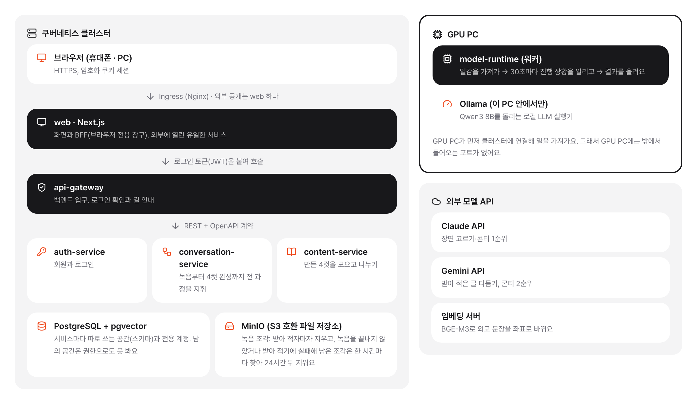

# 아키텍처

[← 4cut story 소개로 돌아가기](https://github.com/4cut-story)

밖에서 보이는 것은 **web 하나**예요. 그 뒤에서 서비스 다섯 개가 역할을 나눠 맡고, GPU가 필요한 일은 GPU PC의 워커가 가져가 처리해요.

| 핵심 설계 | 내용 |
| --- | --- |
| **배포 단위 7개** | 생성 과정은 conversation-service 안 모듈 5개로 나누고, Spring Modulith 테스트로 경계를 지켜요 |
| **큐 서버 없는 대기열** | PostgreSQL 표 + `SKIP LOCKED`. 워커가 30초마다 진행을 알려 90초 임대를 연장해요 |
| **파일은 저장소 주소로** | 녹음·그림은 15분짜리 MinIO 주소로 직접 올리고 받아요. 워커는 저장소 키가 없어요 |
| **토큰은 BFF가 보관** | 암호화 쿠키에만 두고, 브라우저 코드에는 토큰도 백엔드 주소도 없어요 |
| **정해진 방향으로만** | web → gateway → 서비스, conversation → content만 NetworkPolicy로 허용 |
| **자동 배포** | PR(정적 분석 · 커버리지 80%) → GHCR 이미지 → deploy 레포 자동 커밋 → Argo CD 동기화 |

## 서비스별 역할

| 서비스 | 기술 | 역할 | 하는 일 |
| --- | --- | --- | --- |
| **web** | Next.js 16 · React 19 · TypeScript | 화면과 BFF(브라우저 전용 창구). 외부에 열린 유일한 서비스 | 화면을 서버에서 그려 보내 휴대폰에서도 빨리 떠요 로그인 토큰은 암호화한 쿠키에만 두고, 브라우저 코드에는 백엔드 주소가 없어요 자동화 도구는 쿠키 대신 게시 전용 개인 토큰으로 부르고, 이때는 게시에 필요한 경로만 열려요 그림은 공개 범위와 차단 여부를 확인한 뒤에만 보여 줘요. 확인한 그림은 WebP로 바꾸고 화면 폭에 맞게 줄여 보내요(바꾼 결과는 메모리에 캐시) 조회수: 방문자 쿠키를 1년짜리로 붙이고, 백엔드에는 쿠키의 해시만 넘겨요. 봇·크롤러·링크 미리보기는 세지 않아요 화면은 셋으로 나눠요: 피드는 모두의 공개 4컷, 스토리(/@아이디, 공유 주소)는 한 사람의 4컷(주인은 전체·공개·비공개 탭), 프로필(/@아이디/profile)은 소개·숫자·닉네임·계정 관리 |
| **api-gateway** | Spring Cloud Gateway | 백엔드 입구. 로그인 확인과 길 안내 | 로그인 토큰(JWT)의 서명을 공개키로 확인해요 밖에서 몰래 넣은 사용자 정보 헤더는 지우고, 확인한 값만 다시 붙여요 GPU PC 워커 전용 경로는 워커 토큰으로만 열려요 첫 화면, 공개 게시물, 캐릭터 갤러리, 배경음 라이브러리는 로그인하지 않아도 볼 수 있어요 게시물 조회수 남기기도 로그인 없이 열려 있어요 |
| **auth-service** | Spring Boot 4 · Spring Security | 회원과 로그인 | GitHub·Google 로그인, 같은 이메일이 확인되면 두 계정을 자동 연결 닉네임은 프로필에서 직접 정하고(20자 이하), 정하지 않으면 로그인 아이디가 보여요. 주소(/@아이디)는 로그인 아이디 그대로예요 접속 토큰 15분, 갱신 토큰 14일이며 갱신 토큰은 쓸 때마다 새로 바꿔요 개인 토큰(PAT)은 로그인한 회원이 직접 발급해요. 게시 권한만 있고 최대 90일, 언제든 폐기할 수 있어요. 원문은 해시로만 저장하고 발급·사용·폐기를 기록해요 |
| **conversation-service** | Spring Boot 4 · Spring Modulith · Spring AI | 녹음부터 4컷 완성까지 전 과정을 지휘 | 안쪽을 모듈 5개(흐름 관리, 받아 적기, 시나리오, 만화, 캐릭터)로 나누고 서로 공개 창구로만 불러요 GPU 작업 대기열을 관리하고, 실패한 단계부터 자동으로 다시 해요 외부 LLM(Claude, Gemini) 호출과 대체 순서도 여기서 정해요 기사로 만들기: 기사 주소를 SSRF 검사 뒤 대신 열어 본문만 고르고, 칼럼·사설·인터뷰·사진·영상 기사는 거른 뒤 사실만 가져와 새 대화로 각색해 같은 흐름에 넣어요. 각색 전에 핵심 사실과 기사에 맞는 흐름(칭찬, 감동, 풍자 등)을 먼저 기획해 장면 고르기·콘티까지 넘겨요 RSS 구독: 등록한 피드를 30분마다 확인해 새 기사로 한 번에 3편·하루 10편까지 만들고, 최근 3일 안의 비슷한 주제는 임베딩으로 걸러요 |
| **content-service** | Spring Boot 4 | 만든 4컷을 모으고 나누기 | 내 스토리(게시함·게시 안 함으로 걸러 보기), 게시(전체 공개·팔로워만), 피드(전체·팔로잉 탭), 좋아요, 댓글, 팔로우 만화별 조회수: 같은 방문자가 10분 안에 다시 본 것은 한 번으로 세요 완성된 4컷은 conversation-service가 내부 API로 등록해요 |
| **model-runtime** | Python · PyTorch · diffusers · WhisperX | GPU PC에서 도는 작업 프로그램(워커) | DB도 업무 규칙도 없이, 받은 일만 실행하고 결과를 올려요 받아 적기·그림은 직접, LLM은 같은 PC의 Ollama에 넘겨요 |

## 서비스끼리 주고받는 방식

- **REST + OpenAPI 계약** 서비스끼리는 HTTP로 JSON을 주고받아요. 주고받을 모양(계약)을 공통 레포에 먼저 쓰고 버전을 매긴 뒤 구현해서, 한쪽이 바뀌어도 다른 쪽이 깨지지 않게 해요.
- **DB 대기열 (GPU 작업)** GPU 일감은 PostgreSQL 표에 쌓아요. 워커가 한 건씩 잠가 가져가고(SKIP LOCKED), 30초마다 진행 상황을 알려 90초 임대를 연장해요. 소식이 끊기면 다시 대기열로 돌아가요. 사람이 만든 만화가 RSS 뉴스 구독으로 자동으로 만든 만화보다 먼저 그려지고, 대사 읽기는 차례와 상관없이 다른 만화의 그림보다 먼저예요.
- **파일은 저장소 주소로** 녹음과 그림처럼 큰 파일은 본문에 싣지 않고, 15분만 쓸 수 있는 저장소(MinIO) 주소로 직접 올리고 받아요. 워커는 저장소 키를 갖지 않아요.
- **진행 상황 확인** 만드는 동안 화면이 5초마다 진행 상황을 물어봐요. 내 프로필의 '만드는 현황'에서는 내가 등록한 녹음·기사·RSS 기사가 진행 중·완료·못 만듦 중 어디에 있는지 단계와 진행률로 한눈에 보여요. 단계마다 결과를 저장해 두어 중간에 실패해도 그 단계부터 이어서 해요.
- **정해진 방향으로만** web → gateway → 각 서비스, conversation → content 방향만 통신을 허용해요(NetworkPolicy). 클러스터에서 GPU PC로 나가는 연결은 없어요.

## 데이터 저장소

- **PostgreSQL + pgvector**: 서비스마다 따로 쓰는 공간(스키마)과 전용 계정. 남의 공간은 권한으로도 못 봐요 · 표 구조 변경은 Flyway 마이그레이션으로만 · 캐릭터 외모 좌표 1,024차원 + HNSW 색인(m 16, ef_construction 64) · GPU 작업 대기열도 이 DB의 표 하나로 처리 (따로 큐 서버를 두지 않아요)
- **MinIO (S3 호환 파일 저장소)**: 녹음 조각: 받아 적자마자 지우고, 녹음을 끝내지 않았거나 받아 적기에 실패해 남은 조각은 한 시간마다 찾아 24시간 뒤 지워요 · 중간 결과(받아 적은 글, 콘티, 컷 그림): 7일 뒤 자동 삭제 · 완성 4컷·프로필 사진: 사용자가 지울 때까지 · 캐릭터 참조 그림과 IP-Adapter 특징 파일

## GPU 작업 흐름

1. **대기열에 넣기** conversation-service가 할 일(받아 적기, LLM, 그림)을 표에 넣어요
2. **가져가기** 워커가 2~10초 간격으로 물어보다가 한 건을 가져가요. 지금 올려 둔 모델과 같은 종류를 먼저 받아요
3. **진행 알리기** 30초마다 진행률을 보내 임대를 연장해요
4. **결과 올리기** 결과 파일은 받은 저장소 주소로 올리고, 쓴 모델·조건과 걸린 시간을 함께 보고해요

## 로그인 흐름

1. **GitHub·Google 로그인** auth-service가 로그인 결과로 토큰을 만들어요
2. **쿠키에 보관** web이 토큰을 암호화한 쿠키에 넣어요. 브라우저 코드는 토큰을 못 봐요
3. **입구에서 확인** gateway가 공개키로 서명을 확인하고 사용자 ID만 붙여 넘겨요
4. **서비스가 소유권 확인** 내 것인지, 볼 수 있는 공개 범위인지는 각 서비스가 확인해요

## 배포 흐름

1. **PR** 정적 분석 + 테스트 + 커버리지 80%를 넘어야 머지돼요
2. **이미지** 머지되면 커밋 번호로 이름 붙인 컨테이너 이미지를 올려요
3. **배포 레포** 새 이미지 번호를 배포 레포에 자동으로 커밋해요
4. **Argo CD** 배포 레포와 클러스터를 자동으로 맞춰요. 되돌리기는 그 커밋을 되돌리면 끝
