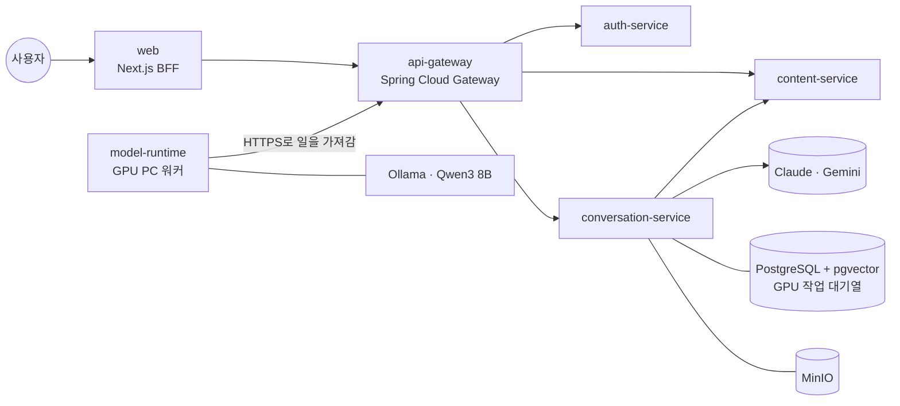

# 4컷 스토리

**대화를 녹음하면 AI가 4컷 만화로 그려 주는 서비스**

[서비스 바로가기](https://4cut.java21.net) · [서비스 소개](https://4cut.java21.net/about) · [그림 모델 비교](https://4cut.java21.net/lab)

---

## 어떤 서비스인가요

가족, 친구와 나눈 대화를 휴대폰 브라우저로 녹음하면, AI가 대화에서 가장 재미있는 순간을 골라 4~10컷 만화로 그려 줘요.
웃음, 반전, 진심, 추억이 담긴 장면을 찾아 기·승·전·결 콘티로 나누고, 고른 그림 테마(7가지)와 사투리에 맞춰 대사를 다듬은 뒤, 컷마다 그림을 그려 말풍선까지 넣은 한 장의 만화로 완성해요.
완성한 만화는 내 스토리에 보관하고, 원하면 피드에 게시해 좋아요·댓글·팔로우로 나눌 수 있어요.

| | |
| --- | --- |
| **5 + 1** | 마이크로서비스 + GPU 워커 |
| **9개** | 단계별로 골라 쓰는 AI 모델 |
| **42,546장** | 캐릭터 1,013명의 참조 그림 |
| **컷당 약 8.6초** | RTX 5060 Ti 16GB 한 장으로 그리는 시간 |

**개인정보를 지키는 방식**: 대화에 나온 실명은 가명으로 바꾸고, 원본 녹음은 받아 적자마자 지워요. 끝내지 않은 녹음도 24시간 안에 자동으로 삭제돼요.

## 만화가 만들어지는 과정

| 단계 | 하는 일 | 모델 | 실행 위치 |
| --- | --- | --- | --- |
| 녹음과 업로드 | 1분 조각으로 녹음해 저장소에 바로 올리고, 녹음 중에도 앞 조각을 미리 받아 적어 기다리는 시간을 줄여요 | | 클러스터 |
| 받아 적기·화자 나누기 | 음성을 글로 옮기고 낱말마다 말한 시각을 맞춘 뒤 누가 한 말인지 나눠요 | WhisperX large-v3, pyannote | GPU PC |
| 글 다듬기 | 잘못 들은 낱말, 띄어쓰기, 숫자 표기를 고쳐요. 150줄씩 4묶음을 동시에 처리해요 | Gemini 3.5 Flash-Lite | 클라우드 API |
| 장면 고르기 | 대화를 10분 구간으로 나눠 동시에 살펴보고 만화로 만들 순간을 골라요 | Claude Opus 5.5 → Gemini → Qwen3 8B | 클라우드 API |
| 콘티와 대사 | 이야기에 맞게 4~10컷을 정하고, 테마별 작가 말투·사투리·맞춤법까지 입혀요. 규칙을 어기면 다섯 번까지 다시 써요 | Claude Opus 5.5 → Gemini → Qwen3 8B | 클라우드 API |
| 캐릭터 찾기 | 콘티의 외모 설명과 가장 비슷한 캐릭터를 1,024차원 임베딩으로 찾아요 | BGE-M3 + pgvector(HNSW) | 임베딩 서버 |
| 컷 그리기 | 긴 장면 설명을 읽어 물건과 인물 수를 따르는 모델로 768×768 그림을 그려요 | FLUX.1-schnell (NF4), 실패 시 DreamShaper XL Lightning + IP-Adapter | GPU PC |
| 한 장으로 합치기 | 컷을 배치하고 말풍선을 코드로 그려 넣어요. 그린 그림을 Claude에게 보여 주고 인물이 실제로 선 자리에 말풍선 꼬리를 맞춰요 | Claude Opus 5.5 | 클러스터 |

## 아키텍처

- **배포 단위 7개**: 생성 과정 전체는 conversation-service 안의 모듈 5개(흐름 관리, 받아 적기, 시나리오, 만화, 캐릭터)로 나누고, Spring Modulith로 모듈 경계를 테스트로 지켜요.
- **GPU PC는 일을 가져가는 방식(pull)**: GPU PC에 포트를 열지 않아요. 워커가 HTTPS로 대기열에서 한 건씩 잠가 가져가고(SKIP LOCKED), 30초마다 진행을 알려 임대를 연장해요. PC가 꺼져 있어도 일은 남아 있다가 켜지면 이어서 처리돼요.
- **큐 서버 없이 PostgreSQL 표 하나로 대기열**: GPU가 한 장이라 한 번에 한 건이면 충분해서 운영할 서버를 늘리지 않았어요.
- **큰 파일은 저장소 주소로**: 녹음과 그림은 15분짜리 MinIO 주소로 바로 올리고 받아요. 워커는 저장소 키를 갖지 않아요.
- **정해진 방향으로만 통신**: web → gateway → 각 서비스, conversation → content 방향만 NetworkPolicy로 허용하고, 외부에 열린 서비스는 web 하나예요.
- **로그인 토큰은 BFF가 보관**: web 서버가 암호화 쿠키에 토큰을 넣어 브라우저 코드는 토큰과 백엔드 주소를 보지 못해요. gateway가 JWT 서명을 공개키로 확인해요.
- **LLM 3단 대체**: Claude → Gemini → GPU PC의 Qwen3 순서로 넘기고, 막힌 곳은 10분 동안 건너뛰어요. 외부 API가 모두 막혀도 만화는 끝까지 만들어져요.

### 배포

## 하드웨어

| | 사양 |
| --- | --- |
| **GPU PC** | NVIDIA RTX 5060 Ti 16GB (Blackwell, CUDA 12.8용 PyTorch), PC 메모리 32GB, Windows. Python 워커 + Ollama |
| **클러스터** | Kubernetes(Rancher), Argo CD, PostgreSQL + pgvector, MinIO |

16GB 한 장으로 받아 적기(약 7GB), LLM(약 7GB), 그림(약 7GB, SDXL 대체 경로는 약 11GB) 묶음을 **한 번에 하나만** 올려 나눠 써요. 워커는 지금 올려 둔 모델과 같은 종류의 일을 먼저 받아 전환 횟수를 줄여요.

## 튜닝과 성능 개선

### 속도와 메모리

| 개선 | 원인 | 해결 | 전 → 후 |
| --- | --- | --- | --- |
| 그림 그리는 시간 | 30단계 다듬기 + 컷마다 GPU↔CPU 이동 | 적은 단계로 그리는 Lightning, 768px로 16GB 안에 다 올리고 CPU offload 끄기 | 30단계 → 8단계, 약 7배 빠르게 |
| 모델 다시 올리는 시간 | 작업이 바뀔 때마다 그림 모델을 디스크에서 다시 읽음 | 내린 모델을 지우지 않고 PC 메모리(32GB)에 보관 | 86~194초 → 1.2~1.4초 |
| 숨어 있던 13% 느려짐 | 화자 분리 모델이 GPU 계산 방식(TF32)을 꺼 놓고 되돌리지 않음 | 화자 분리가 끝나면 원래대로 되돌리기 | 장당 1.5초 → 1.33초 |
| LLM 호출 | 150줄 묶음과 10분 구간을 하나씩 차례로 호출 | 글 다듬기는 4묶음씩, 장면 찾기는 모든 구간을 동시에 | 차례로 → 동시 |
| 그래픽 메모리 나눠 쓰기 | 세 묶음 합계 약 25GB | 한 번에 묶음 하나만, 같은 종류 일 먼저 받기 | 합계 약 25GB → 묶음당 최대 약 11GB |
| 남은 메모리 잘못 읽기 | Windows에서 PyTorch가 다른 프로그램의 사용량을 빼지 않고 보고 | 드라이버(NVML → nvidia-smi)에서 직접 읽기 | 실제 2.9GB인데 13.7GB로 보임 → 드라이버와 같은 값 |

### 16GB GPU에 맞는 그림 모델 고르기 (양자화 비교)

콘티 10편, 47컷을 **같은 프롬프트와 시드, 같은 렌더러**로 다시 그려 편마다 두 번 채점했어요(채점 흔들림 약 3점).

| 방식 | step | 그림 점수 | 컷당 시간 | VRAM 최대 | 판단 |
| --- | --- | --- | --- | --- | --- |
| **FLUX.1-schnell NF4** | 4 | **90.8** | **8.6초** | **6.6GiB** | **운영 중** |
| FLUX.1-dev NF4 | 28 | 90.7 | 42.3초 | 6.6GiB | 점수는 같고 약 5배 느림, 비상업 라이선스 |
| FLUX.1-schnell GGUF Q8_0 | 4 | 90.5 | 10.8초 | 12.4GiB | 점수는 같고 VRAM 약 2배 |
| FLUX.1-schnell int8 | 4 | - | 약 1,230초 | 16GB 넘침 | 중단 |

더 큰 모델이나 더 정밀한 양자화가 점수를 올리지 못해, 가장 빠르고 가벼운 schnell NF4를 그대로 써요. 그린 컷은 [그림 모델 비교 화면](https://4cut.java21.net/lab)에서 나란히 볼 수 있어요.

### 그림 모델을 고르는 방법

점수가 가장 높은 모델을 그대로 쓰지 않고, 아래 네 조건을 먼저 통과한 모델끼리만 겨뤄요.

| 조건 | 왜 보나요 |
| --- | --- |
| 라이선스 | 공개된 모델도 상업 사용이 막혀 있거나(비상업) 조건이 붙은 경우가 많아요. Apache 2.0처럼 서비스에 써도 되는 모델만 남기고, 나머지는 시험 기록에만 남겨요 |
| 16GB 메모리 | RTX 5060 Ti 16GB 한 장에 들어가야 해요. 큰 모델은 4비트로 줄여(양자화) 넣고, 줄여서 점수가 얼마나 떨어지는지도 재요 |
| 속도 | 만화 한 편이 여러 컷이라, 컷당 몇 초 걸리는지가 기다리는 시간을 정해요 |
| 캐릭터 참조 | 캐릭터 DB의 그림을 보고 같은 인물로 그려야 해요. 참조 그림을 받지 못하는 모델은 점수가 높아도 뺐어요 |

참조 없이 그린 FLUX.1-schnell은 90.5~91.2점, IP-Adapter로 참조해서 그린 SDXL은 82.8점이었어요. 그래서 참조할 수 있는 모델끼리 따로 표를 만들어 비교해요.

### 품질 개선 회차

고정한 시험 세트를 고치기 전후로 같은 조건에서 그려 나란히 채점하고, **점수가 오를 때만 수정을 남겨요.** 같은 녹음이 같은 만화를 내도록 시드는 대화 내용으로 정하고, 같은 입력의 LLM 답은 저장해 다시 써요. 한 번에 한 가지만 바꾸고, 한 편에 맞춘 수정이 다른 편을 망치지 않는지 시험 세트로 확인해요.

| 회차에서 고친 것 | 전 → 후 |
| --- | --- |
| 그림체 문구 뒤에 품질 문구 붙이기 | 화질 1.35 → 1.55점 (2점 만점) |
| 그린 그림에서 인물이 선 자리를 확인해 말풍선 맞추기 | 말풍선 1.05 → 1.25점 |
| SDXL 1.0 + Lightning LoRA → DreamShaper XL Lightning | 시험 묶음 81.4 → 83.7점 |
| SDXL → 긴 문장을 읽는 FLUX.1-schnell (T5 글 인코더, NF4) | 시험 묶음 82.8 → 87.9점 |
| 흑백 신문 테마를 옅은 색으로 그린 뒤 흑백 변환 | 화질 1.0 → 약 1.3점 |
| 두 명 컷 인원을 "왼쪽부터 나이·성별"로 세어 적기 | "two people" → "a young woman and an old man" |
| 77토큰을 넘는 그림 설명을 75토큰씩 나눠 읽히기 | 앞 77토큰만 → 설명 전체 |
| 캐릭터 참조(IP-Adapter)를 얼굴만 → 얼굴·머리·옷까지 | 컷마다 옷이 바뀌던 문제 해결 |
| 캐릭터 찾기 거리 기준을 1,288개 문장으로 재서 0.30으로 | 성별·나이 틀림 0건, 맞는 문장 99% 이상 찾음 |
| 짧은 대화에서 장면을 못 찾으면 한 번 더 묻기 | 장면 없음 두 편 → 두 편 모두 게시 |
| 빈 말풍선 막기 (컷당 대사 1~2개, 빈 컷은 실제 말로 채우기) | 빈 컷 0 |

### 안정성

- **콘티 다시 쓰기 중 멈춤**: DB가 시도 번호를 1~3까지만 받아 네 번째 시도에서 4시간 넘게 멈췄던 문제를 마이그레이션으로 1~5로 넓혀 해결했어요.
- **검색 색인 장애**: HNSW 색인을 여러 프로세스로 만들다 DB 공유 메모리가 모자라 배포가 실패하던 문제를 한 프로세스 생성 + 실패해도 기동하는 방식으로 바꿨어요.
- **만화마다 제작 기록**: 그림 모델·양자화·step·시드·GPU, 컷별 그리기 시간, 답한 LLM 모델을 만화마다 남기고 게시물의 '제작 정보'에서 볼 수 있어요.
- **보안 헤더**: HSTS, X-Frame-Options·frame-ancestors, nosniff, Referrer-Policy, Permissions-Policy를 모든 응답에 붙였어요.
- **이용 한도**: 1인 하루 10편으로 외부 LLM과 GPU 사용을 지켜요.

## 기술 스택

| 분야 | 기술 |
| --- | --- |
| 웹 | Next.js 16, React 19, TypeScript, Tailwind CSS v4 |
| 백엔드 | Java 21, Spring Boot 4, Spring Cloud Gateway, Spring Modulith, Spring AI |
| AI 실행 | Python, PyTorch (CUDA 12.8), diffusers, WhisperX, Ollama |
| 데이터 | PostgreSQL, pgvector (HNSW), Flyway, MinIO, Crowfoot (ERD 설계) |
| 운영·품질 | Kubernetes, Argo CD, GitHub Actions, GHCR, nginx-manager (도메인·HTTPS), 커버리지 80% 게이트 |

## 저장소

| 저장소 | 역할 | 기술 |
| --- | --- | --- |
| [web](https://github.com/4cut-story/web) | 화면과 BFF. 외부에 열린 유일한 서비스 | Next.js 16 · React 19 · TypeScript |
| [api-gateway](https://github.com/4cut-story/api-gateway) | 백엔드 입구. JWT 확인과 길 안내, 워커 전용 경로 | Spring Cloud Gateway |
| [auth-service](https://github.com/4cut-story/auth-service) | GitHub·Google 로그인, 토큰 발급, 개인 액세스 토큰(PAT) | Spring Boot 4 · Spring Security |
| [conversation-service](https://github.com/4cut-story/conversation-service) | 녹음부터 만화 완성까지 전 과정 지휘, GPU 작업 대기열, LLM 대체 순서 | Spring Boot 4 · Spring Modulith · Spring AI |
| [content-service](https://github.com/4cut-story/content-service) | 내 스토리, 게시, 피드, 좋아요, 댓글, 팔로우 | Spring Boot 4 |
| [model-runtime](https://github.com/4cut-story/model-runtime) | GPU PC 워커. 받아 적기·그림은 직접, LLM은 Ollama로 | Python · PyTorch · diffusers · WhisperX |
| [common](https://github.com/4cut-story/common) | 서비스끼리 주고받는 OpenAPI 계약과 공통 코드 | |
| [deploy](https://github.com/4cut-story/deploy) | 쿠버네티스 배포 설정. Argo CD가 이 레포를 보고 클러스터를 맞춰요 | Kubernetes · Argo CD |

## 직접 만들어 쓰는 도구

- **[Crowfoot](https://crowfoot.java21.net)** ([GitHub](https://github.com/crowfoot-erd)): 무료 온라인 ERD 툴. 이 서비스의 PostgreSQL 설계(표 14개, 요구사항 16개)를 Crowfoot으로 하고, AI 코딩 에이전트가 Crowfoot MCP로 요구사항과 ERD를 고쳤어요.
- **[nginx-manager](https://github.com/nginx-manager)**: 웹 화면으로 nginx와 Let's Encrypt 인증서를 관리하는 도구. 이 서비스의 도메인 연결과 HTTPS 인증서를 맡아요.

---

더 자세한 모델 설정, 설계 결정, 용어 풀이는 **[서비스 소개 페이지](https://4cut.java21.net/about)** 에서 볼 수 있어요.

