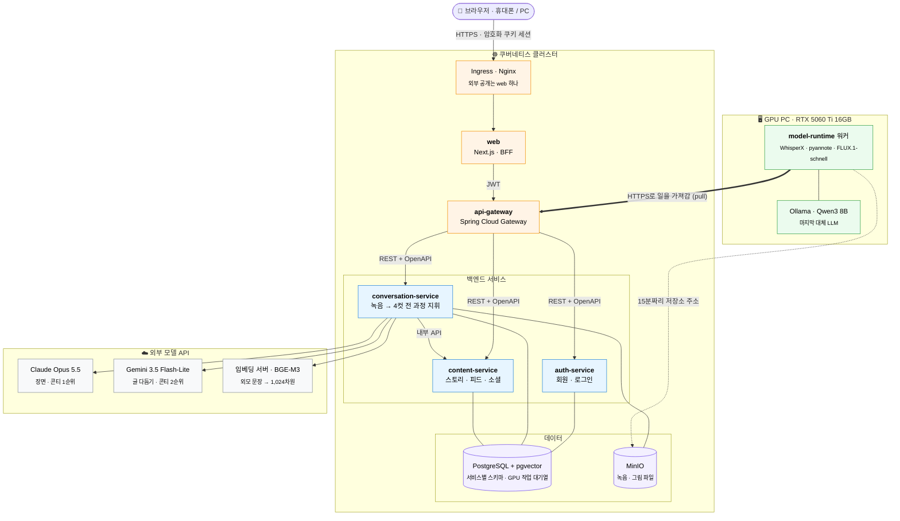
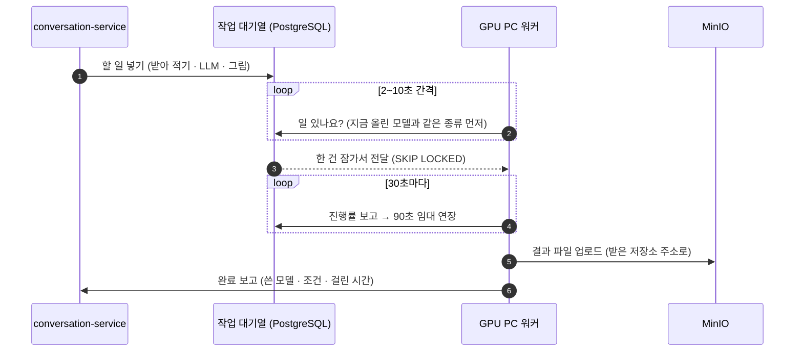
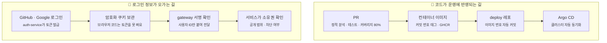
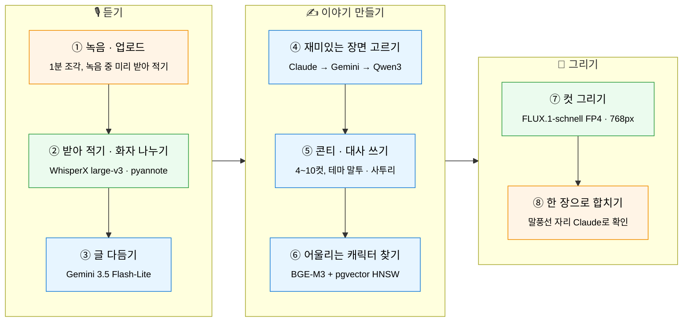
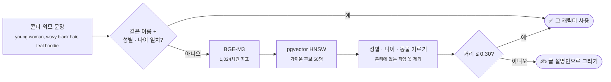
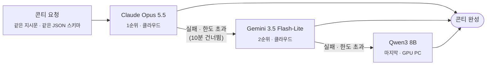

# 4컷 스토리

### 대화를 녹음하면, AI가 가장 재미있는 순간을 골라 4컷 만화로 그려 줘요

**데모 사이트: [4cut.java21.net](https://4cut.java21.net)**

---

## 한눈에 보기

친구, 가족과 나눈 대화를 휴대폰 브라우저로 녹음하면 받아 적고, 웃음·반전·진심·추억이 담긴 순간을 골라 **4~10컷 만화**로 그려요. 그림 테마 7가지와 사투리에 맞춰 대사를 다듬고, 컷마다 그림을 그려 말풍선까지 넣은 한 장으로 완성해요. 완성한 만화는 내 스토리에 보관하고, 원하면 피드에 올려 좋아요·댓글·팔로우로 나눠요.

마이크로서비스 다섯 개가 쿠버네티스 위에서 전체 과정을 관리하고, **RTX 5060 Ti 16GB 한 장짜리 GPU PC**가 음성 인식과 그림을 맡아요.

| 5 + 1 | 9개 | 42,546장 | 약 5.6초 |
| :---: | :---: | :---: | :---: |
| 마이크로서비스 + GPU 워커 | 단계별로 골라 쓰는 AI 모델 | 캐릭터 1,013명의 참조 그림 | 4컷 그림 네 장 그리기 |

### 실제로 그린 컷

콘티 한 편(곰과 토끼의 마트 시식 코너 이야기)을 지금 운영 중인 FLUX.1-schnell nunchaku FP4로 그린 네 컷이에요. 말풍선은 합치기 단계에서 코드로 넣기 때문에, 여기서는 그림만 보여 줘요.

<table><tr><td></td><td></td><td></td><td></td></tr>
<tr><td align="center">① 시식 쟁반을 노리는 곰</td><td align="center">② 모자를 눌러쓰고 몰래 접근</td><td align="center">③ 이쑤시개를 든 채 얼어붙음</td><td align="center">④ 만두 두 봉지를 든 토끼</td></tr></table>

### 이 프로젝트에서 눈여겨볼 것

- **소비자용 GPU 한 장으로 전 과정 운영**: 합계 약 25GB가 필요한 모델 세 묶음을 16GB에 나눠 올리고, 모델 전환 시간을 **86~194초에서 1.2~1.4초**로 줄였어요.
- **포트를 열지 않는 GPU 연결**: GPU PC 워커가 HTTPS로 일을 가져가는(pull) 구조라, PC가 꺼져 있어도 일은 대기열에 남았다가 켜지면 이어서 처리돼요.
- **측정으로 고르는 모델**: 같은 콘티 10편·47컷을 같은 프롬프트·시드로 14가지 방식으로 다시 그려 채점하고, 점수·속도·메모리·라이선스로 운영 모델을 정했어요.
- **멈추지 않는 LLM 3단 대체**: Claude → Gemini → GPU PC의 Qwen3 8B 순서로 넘겨, 외부 API가 모두 막혀도 만화가 끝까지 만들어져요.
- **점수가 오를 때만 남기는 개선**: 고정한 시험 세트를 고치기 전후로 같은 조건에서 그려 채점하고, 오른 수정만 남겨요. 그림 점수를 81.4점에서 91.2점까지 올렸어요.
- **개인정보 보호**: 대화 속 실명은 가명으로 바꾸고, 원본 녹음은 받아 적자마자 지워요. 끝내지 않은 녹음도 24시간 안에 자동으로 삭제돼요.

---

## 전체 아키텍처

밖에서 보이는 것은 web 하나예요. 그 뒤에서 서비스 다섯 개가 역할을 나눠 맡고, GPU가 필요한 일은 GPU PC의 워커가 가져가 처리해요.

### 서비스마다 하는 일

| 서비스 | 기술 | 하는 일 |
| --- | --- | --- |
| [**web**](https://github.com/4cut-story/web) | Next.js 16 · React 19 · TypeScript | 화면과 BFF(브라우저 전용 창구). 외부에 열린 유일한 서비스. 로그인 토큰은 암호화 쿠키에만 두고 브라우저 코드에는 백엔드 주소가 없어요 |
| [**api-gateway**](https://github.com/4cut-story/api-gateway) | Spring Cloud Gateway | 백엔드 입구. JWT 서명을 공개키로 확인하고, 밖에서 넣은 사용자 헤더는 지운 뒤 확인한 값만 붙여요. 워커 전용 경로는 워커 토큰으로만 열려요 |
| [**auth-service**](https://github.com/4cut-story/auth-service) | Spring Boot 4 · Spring Security | GitHub·Google 로그인과 계정 자동 연결. 접속 토큰 15분, 갱신 토큰 14일(쓸 때마다 교체). 게시 전용 개인 토큰(PAT)은 최대 90일, 해시로만 저장 |
| [**conversation-service**](https://github.com/4cut-story/conversation-service) | Spring Boot 4 · Spring Modulith · Spring AI | 녹음부터 4컷 완성까지 지휘. 모듈 5개(흐름 관리, 받아 적기, 시나리오, 만화, 캐릭터)로 나누고, GPU 작업 대기열과 LLM 대체 순서를 관리해요 |
| [**content-service**](https://github.com/4cut-story/content-service) | Spring Boot 4 | 내 스토리, 게시(전체 공개·팔로워만), 피드, 좋아요, 댓글, 팔로우 |
| [**model-runtime**](https://github.com/4cut-story/model-runtime) | Python · PyTorch · diffusers · WhisperX | GPU PC 워커. DB도 업무 규칙도 없이 받은 일만 실행하고 결과를 올려요 |

### 서비스끼리 주고받는 방식

| 방식 | 내용 |
| --- | --- |
| **REST + OpenAPI 계약** | 주고받을 모양을 [common](https://github.com/4cut-story/common) 레포에 먼저 쓰고 버전을 매긴 뒤 구현해, 한쪽이 바뀌어도 다른 쪽이 깨지지 않아요 |
| **DB 대기열 (GPU 작업)** | 큐 서버 없이 PostgreSQL 표 하나로. 워커가 한 건씩 잠가 가져가고(SKIP LOCKED) 30초마다 진행을 알려 90초 임대를 연장해요. 소식이 끊기면 다시 대기열로 |
| **파일은 저장소 주소로** | 녹음과 그림은 15분짜리 MinIO 주소로 직접 올리고 받아요. 워커는 저장소 키를 갖지 않아요 |
| **정해진 방향으로만** | web → gateway → 각 서비스, conversation → content만 NetworkPolicy로 허용. 클러스터에서 GPU PC로 나가는 연결은 없어요 |

### 세 가지 흐름

---

## 생성 흐름

사용자는 녹음만 해요. 나머지 단계는 conversation-service가 차례로 돌리고, 단계마다 결과를 저장해 두어 실패한 단계부터 자동으로 다시 시도해요.

🟩 GPU PC · 🟦 클라우드 API · 임베딩 서버 · 🟧 클러스터

| 단계 | 하는 일 |
| --- | --- |
| **① 녹음과 업로드** | 1분 조각으로 녹음해 저장소에 바로 올리고, 녹음하는 동안 먼저 올라온 조각을 미리 받아 적어 기다리는 시간을 줄여요. GPU PC가 꺼져 있으면 녹음 전에 알려 줘요 |
| **② 받아 적기·화자 나누기** | 음성을 글로 옮기고 낱말마다 말한 시각을 맞춘 뒤 누가 한 말인지 나눠요. 실명은 가명으로, 원본 녹음은 받아 적자마자 삭제 |
| **③ 글 다듬기** | 잘못 들은 낱말, 띄어쓰기, 숫자 표기를 고치고 소음을 말로 착각한 줄을 지워요. 150줄씩 4묶음을 동시에, 말투와 사투리는 그대로 |
| **④ 장면 고르기** | 대화를 10분 구간으로 나눠 동시에 살펴보고, 그 장면을 특별하게 만든 한 마디와 함께 순위를 매겨요. 짧은 대화에서 못 찾으면 한 번 더 묻고, 그래도 없으면 일기 같은 만화로 |
| **⑤ 콘티와 대사** | 기·승·전·결로 나누고 컷 수를 4~10컷 중에서 골라요. 테마 7가지마다 작가 말투(무협은 무협지, 조선은 사극), 사투리, 맞춤법, 호칭까지. 규칙을 어기면 다섯 번까지 다시 써요 |
| **⑥ 캐릭터 찾기** | 콘티의 외모 문장과 가장 비슷한 캐릭터를 1,013명 중에서 찾아요(아래 [캐릭터 찾기](#캐릭터-찾기)) |
| **⑦ 컷 그리기** | 긴 장면 설명을 읽는 FLUX.1-schnell로 768×768. 두 명 컷은 인물마다 왼쪽·오른쪽 자리를 고정하고 "a young woman and an old man"처럼 왼쪽부터 세어 적어요 |
| **⑧ 한 장으로 합치기** | 컷을 배치하고 말풍선을 코드로 그려 넣어요. 다 그린 그림을 Claude에게 보여 주고 인물이 실제로 선 쪽과 얼굴 위치를 받아, 말풍선 꼬리가 말한 사람을 가리키게 해요 |

---

## 캐릭터 찾기

대화 속 사람에게 어울리는 캐릭터를 1,013명 중에서 골라 모든 컷에서 같은 인물로 그려요. 이름이나 키워드가 정확히 같아야만 찾는 방식은 "웨이브 머리 vs 곱슬머리"처럼 조금만 다르게 묘사해도 놓쳐서, 외모 문장을 **뜻이 담긴 좌표(임베딩)** 로 바꿔 거리로 찾아요.

- **거리 기준 0.30**: 테마 7개, 여러 문장 형식, 한국어, DB에 없는 존재(로봇, 용, 나무)까지 **1,288개 문장**으로 재서 정했어요. 맞는 캐릭터가 있는 문장은 99% 이상 찾고, 없는 문장은 7%만 잘못 받아요.
- **성별·나이 거르기를 함께 두는 이유**: 머리색·옷 색이 같다는 이유로 성별이나 나이가 다른 캐릭터가 아주 가깝게(0.1 안쪽) 나오는 경우가 있었어요. 거르기를 더한 뒤 틀림은 0건이에요.
- **캐릭터 DB**: 1,013명 × 그림 테마 7가지(일상, 동물, 수채화, 그림책, 신문 만화, 조선, 무협) × 표정 6가지 = **42,546장**. Claude와 함께 짠 SVG 그림 생성 코드로 그렸어요. 같은 캐릭터가 일상에서는 의사 가운, 조선에서는 의녀 한복을 입어요.

---

## 하드웨어와 16GB 운영

유료 GPU 서버 없이 소비자용 GPU 한 장으로 돌려요.

| | 사양 |
| --- | --- |
| **GPU PC** | NVIDIA RTX 5060 Ti 16GB (Blackwell, CUDA 12.8용 PyTorch) · PC 메모리 32GB · Windows · Python 워커 + Ollama |
| **클러스터** | 쿠버네티스(Rancher) · Argo CD · PostgreSQL + pgvector · MinIO · NetworkPolicy |

| VRAM 묶음 | 사용량 | 모델 |
| --- | --- | --- |
| 받아 적기 | 약 7GB / 16GB | WhisperX large-v3 + 시각 정렬 모델 + pyannote |
| LLM | 약 7GB / 16GB | Qwen3 8B 4비트 (대체 경로일 때만) |
| 그림 | 최대 약 6.1GB / 16GB | FLUX.1-schnell nunchaku FP4 (실패하면 DreamShaper XL Lightning + IP-Adapter, 약 11GB) |

세 묶음을 한꺼번에 올리면 약 25GB라, **한 번에 한 묶음만** 올려요. 화면 출력 몫으로 약 2GB를 남기고, 올리기 전에 남은 메모리를 드라이버에서 직접 읽어 모자라면 작업을 대기열로 돌려보내요. 워커는 지금 올린 모델과 같은 종류의 일을 먼저 받아 전환 횟수를 줄여요.

> **회고: 16GB 한 장으로 끝까지 가기**
> 더 큰 GPU를 바라기보다 "무엇을 GPU에 꼭 두고, 무엇을 밖으로 뺄지"를 먼저 정했어요. 녹음과 그림은 밖으로 보내지 않고 직접 처리하고, 글을 다루는 일은 클라우드에 맡기고, 내린 모델은 PC 메모리(32GB)에 보관해 전환 비용을 숨겼어요. 768px·적은 step·8B LLM·한 번에 한 작업을 내려놓은 대신, 4컷 그림 약 5.6초와 모델 전환 1.2~1.4초를 얻었어요. 그림 속도보다 모델을 다시 올리는 시간(86~194초)이 훨씬 컸고, 이것을 1초대로 줄인 것이 가장 큰 개선이었어요.

---

## 사용한 AI 모델

모델 하나로 다 하지 않고, 단계마다 잘하는 모델을 골라 이어 붙였어요.

| 모델 | 위치 | 맡은 일 | 고른 이유와 설정 |
| --- | --- | --- | --- |
| **WhisperX large-v3** | GPU PC | 받아 적기 (한국어·영어) | 낱말 단위 시각 정렬과 화자 나누기를 한 번에 붙일 수 있어요. batch 8, fp16 |
| **pyannote** | GPU PC | 화자 나누기 | WhisperX 공식 화자 분리. 최소 2명으로 나누고, 끝나면 TF32 설정을 되돌려요 |
| **Claude Opus 5.5** | 클라우드 | 장면·콘티 1순위, 그린 컷에서 인물 위치 확인 | JSON 스키마 구조화 출력. effort 중간, 120초 제한, 같은 입력은 저장한 답 재사용 |
| **Gemini 3.5 Flash-Lite** | 클라우드 | 글 다듬기, 콘티 2순위 | 빠르고 가벼워 150줄씩 4묶음 동시 처리. temperature 0.4 |
| **Qwen3 8B** | GPU PC | 콘티 마지막 대체 | 외부가 모두 막혀도 끝까지 만들기 위한 안전망. 4비트 약 7GB, 16,384토큰, thinking 끔 |
| **BGE-M3** | 임베딩 서버 | 외모로 캐릭터 찾기 | 요청 수 제한이 없고 한국어·영어를 같은 공간에. 1,024차원 |
| **FLUX.1-schnell** | GPU PC | 컷 그림 (운영) | T5 글 인코더로 긴 문장을 읽어 물건·인원을 잘 따라요. nunchaku FP4, 4 step, 컷당 약 2.9초 |
| **DreamShaper XL Lightning** | GPU PC | FLUX 실패 시 대체 | IP-Adapter로 캐릭터 참조 가능. 6 step, guidance 2 |
| **IP-Adapter Plus (ViT-H)** | GPU PC | SDXL에서 같은 인물 유지 | 얼굴·머리·옷까지 참조. 두 명 컷은 좌우 마스크로 나눠 넣어요 |

---

## 그림 모델 비교

16GB GPU에서 더 큰 모델이나 더 정밀한 양자화가 만화를 나아지게 하는지 재기 위해, **콘티 10편 47컷을 같은 프롬프트·같은 시드·같은 렌더러**로 여러 방식으로 다시 그렸어요. 말풍선 없이 그림만 채점했고, 편마다 두 번 채점해 평균했어요(채점 흔들림 약 3점).

### 고르는 기준

점수가 가장 높은 모델을 그대로 쓰지 않고, 네 조건을 먼저 통과한 모델끼리만 겨뤄요.

| 조건 | 왜 보나요 |
| --- | --- |
| **라이선스** | 공개 모델도 상업 사용이 막혀 있는(비상업) 경우가 많아요. Apache 2.0처럼 서비스에 쓸 수 있는 모델만 남기고, 나머지는 시험 기록에만 남겨요 |
| **16GB 메모리** | RTX 5060 Ti 16GB 한 장에 들어가야 해요. 큰 모델은 4비트로 줄이고, 줄여서 점수가 얼마나 떨어지는지 재요 |
| **속도** | 만화 한 편이 여러 컷이라 컷당 시간이 곧 기다리는 시간이에요 |
| **캐릭터 참조** | 캐릭터 DB의 그림을 보고 같은 인물로 그려야 해요. 참조 그림을 받는 방식과 받지 않는 방식은 따로 순위를 매겨요 |

### 캐릭터 참조 없이 그린 방식 (회차 29)

| 방식 | step | 그림 점수 | 컷당 시간 | VRAM 최대 | 라이선스 | 판단 |
| --- | :---: | :---: | :---: | :---: | --- | --- |
| **FLUX.1-schnell nunchaku FP4** | 4 | **91.2** | **2.9초** | **6.1GiB** | Apache 2.0 | ✅ **채택 (운영)** |
| FLUX.1-schnell NF4 | 4 | 90.8 | 8.6초 | 6.6GiB | Apache 2.0 | 이전 기준 |
| FLUX.1-schnell GGUF Q6_K | 4 | 91.1 | 12.5초 | 9.7GiB | Apache 2.0 | 점수 같고 느리고 무거움 |
| FLUX.1-schnell GGUF Q4_K_S | 4 | 90.8 | 11.0초 | 6.8GiB | Apache 2.0 | 점수 같고 느림 |
| FLUX.1-schnell GGUF Q5_K_S | 4 | 90.7 | 12.3초 | 8.3GiB | Apache 2.0 | 점수 같고 느림 |
| FLUX.1-schnell GGUF Q8_0 | 4 | 90.5 | 10.8초 | 12.4GiB | Apache 2.0 | VRAM 약 2배 |
| FLUX.1-schnell fp8 | 4 | 90.5 | 13.6초 | 14.5GiB | Apache 2.0 | 가장 느리고 무거움 |
| FLUX.1-schnell int8 | 4 | - | 약 20분 | 16GB 넘침 | Apache 2.0 | 중단 |
| FLUX.1-dev nunchaku FP4 + Hyper-SD 8 step | 8 | 93.1 | 4.5초 | 6.3GiB | 비상업 | 최고점이지만 서비스에 쓸 수 없음 |
| FLUX.1-dev nunchaku FP4 | 28 | 90.8 | 10.2초 | 6.1GiB | 비상업 | 탈락 |
| FLUX.1-dev NF4 | 28 | 90.7 | 42.3초 | 6.6GiB | 비상업 | 약 5배 느림 |

**결론**: 더 큰 모델이나 더 정밀한 양자화는 점수를 의미 있게 올리지 못했어요. 상업 사용이 되는 방식 중 점수가 같으면서 **약 3배 빠르고 가장 가벼운 schnell nunchaku FP4**로 운영 모델을 바꿨어요. 50번대 GPU가 바로 계산하는 4비트(FP4) 연산을 쓰는 방식이에요.

### 같은 콘티, 다른 그림 모델

같은 프롬프트와 같은 시드(332981179)로 그린 결과예요. 점수는 이 편의 그림 점수(100점 만점)예요.

<table>
<tr><th>방식</th><th>①</th><th>②</th><th>③</th><th>④</th></tr>
<tr><td><b>schnell nunchaku FP4</b> 채택 · 95.3점 · 컷당 2.9초</td><td></td><td></td><td></td><td></td></tr>
<tr><td><b>schnell NF4</b> 이전 기준 · 94.9점 · 8.6초</td><td></td><td></td><td></td><td></td></tr>
<tr><td><b>schnell GGUF Q8_0</b> 95.8점 · 10.8초 · VRAM 12.4GiB</td><td></td><td></td><td></td><td></td></tr>
<tr><td><b>dev FP4 + Hyper-SD</b> 비상업 · 94.9점 · 4.5초</td><td></td><td></td><td></td><td></td></tr>
</table>

네 방식 모두 장소·소품·인물 수를 비슷하게 따르고 점수 차는 채점 흔들림(약 3점) 안이에요. 그래서 그림이 같다면 빠르고 가볍고 상업 사용이 되는 쪽을 골랐어요.

이 편의 컷별 프롬프트

| 컷 | 프롬프트 (그림체·품질 문구 뒤 장면 부분) |
| --- | --- |
| ① | two people, side by side, (bear, red cap) on the left, (rabbit, green apron) on the right, the bear eyes a dumpling sample tray, the rabbit holds a shopping basket, supermarket aisle |
| ② | bear pulls a red cap low and sneaks to the dumpling stand, sneaky grin, steaming sample tray, freezer shelves |
| ③ | close up shot, bear in a red cap freezes holding a dumpling toothpick by the sample tray, sweat drop |
| ④ | rabbit laughs holding two dumpling bags, supermarket checkout, cash register |

### 캐릭터 참조로 그린 방식

| 방식 | 그림 점수 | 비고 |
| --- | :---: | --- |
| SDXL (DreamShaper XL Lightning) + IP-Adapter Plus | 82.8 | 같은 인물 유지는 되지만 긴 장면 설명을 잘 따르지 못함 |
| 참조 없는 FLUX.1-schnell (비교용) | 90.5~91.2 | 옷·머리는 콘티의 외모 글로만 맞춤 |

참조 없이 그린 방식과 참조로 그린 방식은 점수 차가 커서 한 표에서 겨루지 않고, 참조할 수 있는 모델끼리 따로 비교해요.

---

## 설계 결정과 대안

| 갈림길 | 선택 | 버린 대안 | 이유 |
| --- | --- | --- | --- |
| 컷 수 | Claude가 이야기에 맞게 4~10컷 | 늘 4컷, 또는 사용자가 고르기 | 사건이 여러 번 이어지면 4컷에서 중요한 순간이 빠져요. 그림 시간이 컷 수만큼 늘어서 10컷까지 |
| GPU PC 연결 | 워커가 일을 가져가는 pull | 클러스터가 GPU PC를 직접 호출 | 포트·고정 주소가 필요 없고, PC가 꺼져 있어도 일이 대기열에 남아요 |
| 서비스 크기 | 배포 단위 7개, 생성 과정은 한 서비스 안 모듈 | 단계별 서비스(레포 17개, 배포 단위 11개) | 규모에 비해 운영 부담이 컸어요. 모듈 경계는 Spring Modulith 테스트로 지키고, 측정으로 필요가 확인되면 떼어내요 |
| 작업 대기열 | PostgreSQL 표 + 행 잠금 | Redis·메시지 큐 서버 | GPU가 한 장이라 한 번에 한 건이면 충분해요 |
| 캐릭터 검색 | 기존 PostgreSQL + pgvector | 별도 벡터 DB | 수만 장 규모는 HNSW 색인 하나로 충분하고, 캐릭터 정보와 함께 조회돼요 |
| 토큰 보관 | web 서버가 암호화 쿠키로(BFF) | 브라우저 저장소 | 브라우저 코드가 토큰에 닿지 못해 탈취 위험이 줄어요 |
| LLM 위치 | 클라우드 우선 + 로컬 모델 안전망 | 로컬 모델만 | 콘티 품질과 속도는 클라우드, 외부가 모두 막혀도 끝까지는 로컬 |
| 배포 | Argo CD 자동 동기화 | 사람이 태그를 바꾸는 수동 반영 | 머지 후 몇 분 안에 반영. 품질은 머지 전 CI(커버리지 80%)가 막아요 |
| 그림 모델 | 라이선스·16GB·속도·참조로 거른 뒤 점수 비교 | 최고점 모델 그대로 | 최고점(93.1)은 비상업 라이선스였어요 |
| 그림 설명 언어 | 짧은 영어 | 한국어 그대로 | 이미지 모델은 앞 77토큰만 읽고 영어로 학습돼, 한국어 설명은 잘려 장면이 사라졌어요 |

---

## 성능 개선과 문제 해결

고정한 시험 세트를 고치기 전후로 같은 조건에서 그려 나란히 채점하고, **점수가 오를 때만 수정을 남겨요.** 같은 녹음이 같은 만화를 내도록 시드는 대화 내용으로 정하고, 같은 입력의 LLM 답은 저장해 다시 써요.

### 속도와 메모리

| 개선 | 원인 | 해결 | 전 → 후 |
| --- | --- | --- | --- |
| 모델 다시 올리는 시간 | 작업이 바뀔 때마다 디스크에서 다시 읽음 | 내린 모델을 PC 메모리(32GB)에 보관 | **86~194초 → 1.2~1.4초** |
| 컷 그리는 시간 | 4비트 NF4를 일반 연산으로 풀어 계산 | nunchaku FP4로 50번대 GPU의 4비트 연산 사용 | **컷당 8.6초 → 2.9초** |
| SDXL 그림 시간 | 30단계 다듬기 + 컷마다 GPU↔CPU 이동 | Lightning, 768px로 16GB 안에 올리고 CPU offload 끄기 | 30단계 → 8단계, 약 7배 |
| 숨어 있던 13% 느려짐 | 화자 분리가 TF32를 꺼 놓고 되돌리지 않음 | 끝나면 원래대로 되돌리기 | 장당 1.5초 → 1.33초 |
| LLM 호출 | 묶음과 구간을 하나씩 차례로 호출 | 글 다듬기 4묶음 동시, 장면 찾기 구간 전체 동시 | 차례로 → 동시 |
| VRAM 나눠 쓰기 | 세 묶음 합계 약 25GB | 한 번에 한 묶음, 같은 종류 일 먼저 | 합계 25GB → 묶음당 최대 약 11GB |
| 남은 메모리 잘못 읽기 | Windows에서 PyTorch가 다른 프로그램 사용량을 빼지 않음 | 드라이버(nvidia-smi)에서 직접 읽기 | 2.9GB인데 13.7GB로 보임 → 정확 |

### 그림과 만화 품질

| 고친 것 | 전 → 후 |
| --- | --- |
| SDXL 1.0 + Lightning LoRA → DreamShaper XL Lightning | 시험 묶음 81.4 → 83.7점 |
| SDXL → 긴 문장을 읽는 FLUX.1-schnell (T5 글 인코더) | 시험 묶음 82.8 → 87.9점 |
| 양자화 비교로 schnell nunchaku FP4 채택 | 90.8 → 91.2점, 컷당 8.6 → 2.9초 |
| 그림체 문구 뒤에 품질 문구 붙이기 | 화질 1.35 → 1.55점 (2점 만점) |
| 그린 그림을 Claude에게 보여 주고 말풍선 자리 맞추기 | 말풍선 1.05 → 1.25점 |
| 흑백 신문 테마를 옅은 색으로 그린 뒤 흑백 변환 | 화질 1.0 → 약 1.3점 |
| 한국어 설명(약 274토큰)을 짧은 영어로, 장면을 앞에 | 장면 잘림 → 77토큰 안 |
| 두 명 컷 인원을 "왼쪽부터 나이·성별"로 세어 적기 | "two people" → 사람 수·성별 일치 |
| 컷마다 장소·소품 2~3개·표정을 따로 적기 | 13편 중 5편 소품 누락 → 해결 |
| 참조 컷은 컷마다 시드 바꾸기 | 13편 중 5편 같은 자세 → 해결 |
| 다른 사람이 있으면 참조를 그림 가운데에만 | 13편 중 3편 주인공 중복 → 해결 |
| 말풍선의 이름을 호칭(할머니, 손녀…)으로, 조사까지 맞춤 | 말풍선에 이름 → 호칭 + 아래 등장인물 소개 |
| 캐릭터 찾기 거리 기준 0.30 + 성별·나이 거르기 | 성별·나이 틀림 0건, 맞는 문장 99% 이상 |
| 짧은 대화에서 장면을 못 찾으면 한 번 더 묻기 | 장면 없음 두 편 → 두 편 모두 게시 |
| 컷당 대사 1~2개, 빈 컷은 실제 말로 채우기 | 빈 말풍선 0 |
| 캐릭터 DB에 없는 인물은 컷에서 얼굴을 잘라 소개 그림으로 | 회색 빈칸 → 얼굴 그림 |

### 안정성과 보안

| 문제 | 해결 |
| --- | --- |
| 외부 LLM이 막히면 만화가 멈춤 | Claude → Gemini → Qwen3 3단 대체, 막힌 곳은 10분 건너뛰기 |
| 콘티 다시 쓰기 중 4시간 넘게 멈춤 | DB 시도 번호 제약을 1~3에서 1~5로 넓히는 마이그레이션 |
| HNSW 색인 생성 중 공유 메모리 부족으로 배포 실패 | 한 프로세스로 생성, 실패해도 이름 검색만으로 기동 |
| 동시에 겹친 토큰 갱신으로 로그아웃 | 같은 갱신 토큰은 한 번만 보내고 30초 동안 결과 공유 |
| 실패한 녹음이 저장소에 남음 | 한 시간마다 훑어 24시간 지난 녹음 삭제 |
| 끝없이 만들 수 있던 만화 | 1인 하루 10편 제한 |
| 보안 헤더 없음 | HSTS, X-Frame-Options·frame-ancestors, nosniff, Referrer-Policy, Permissions-Policy 적용, x-powered-by 끔 |
| 만화가 어떻게 만들어졌는지 모름 | 만화마다 그림 모델·양자화·step·시드·GPU·컷별 시간·LLM 모델을 남기고 게시물 '제작 정보'로 공개 |

---

## 기술 스택과 품질 기준

모든 레포는 PR마다 **정적 분석과 테스트 커버리지 80%**를 통과해야 머지돼요. 서비스 간 통신은 OpenAPI 계약을 먼저 쓰고 구현해요.

| 분야 | 기술 |
| --- | --- |
| 웹 | Next.js 16 · React 19 · TypeScript · Tailwind CSS v4 |
| 백엔드 | Java 21 · Spring Boot 4 · Spring Cloud Gateway · Spring Modulith · Spring AI |
| AI 실행 | Python · PyTorch (CUDA 12.8) · diffusers · nunchaku · WhisperX · Ollama |
| 데이터 | PostgreSQL · pgvector (HNSW) · Flyway · MinIO · Crowfoot (ERD 설계) |
| 운영·품질 | Kubernetes · Argo CD · GitHub Actions · GHCR · nginx-manager · 커버리지 80% 게이트 |

## 저장소

| 저장소 | 역할 |
| --- | --- |
| [web](https://github.com/4cut-story/web) | 화면과 BFF |
| [api-gateway](https://github.com/4cut-story/api-gateway) | 백엔드 입구, JWT 확인, 워커 전용 경로 |
| [auth-service](https://github.com/4cut-story/auth-service) | 로그인, 토큰, 개인 액세스 토큰 |
| [conversation-service](https://github.com/4cut-story/conversation-service) | 생성 과정 지휘, GPU 작업 대기열, LLM 대체 |
| [content-service](https://github.com/4cut-story/content-service) | 스토리, 피드, 소셜 |
| [model-runtime](https://github.com/4cut-story/model-runtime) | GPU PC 워커, 그림 모델 비교 기록 |
| [common](https://github.com/4cut-story/common) | OpenAPI 계약과 공통 코드 |
| [deploy](https://github.com/4cut-story/deploy) | 쿠버네티스 배포 설정 (Argo CD) |
| [docs](https://github.com/4cut-story/docs) | 설계 문서와 개선 기록 |

## 직접 만들어 쓰는 도구

| 도구 | 무엇인가요 | 이 프로젝트에서는 |
| --- | --- | --- |
| **[Crowfoot](https://crowfoot.java21.net)** ([GitHub](https://github.com/crowfoot-erd)) | 설계부터 DB 생성까지 하는 무료 온라인 ERD 툴. 실시간 협업, DDL·마이그레이션 생성, pgvector·HNSW 설계, MCP 서버 | PostgreSQL 설계(표 14개, 요구사항 16개)를 Crowfoot 문서 하나로 하고, AI 코딩 에이전트가 MCP로 요구사항과 ERD를 고쳤어요. 설계를 DDL로 뽑아 서비스마다 Flyway V1로 나눴어요 |
| **[nginx-manager](https://github.com/nginx-manager)** | nginx와 관리 화면을 컨테이너 두 개로 띄우는 웹 관리 도구. 인증서 자동 발급·갱신, 실패 시 자동 롤백 | 이 서비스의 도메인 연결과 HTTPS 인증서 발급·갱신을 맡아요 |

---

### 직접 써 보세요

**[4cut.java21.net](https://4cut.java21.net)**

