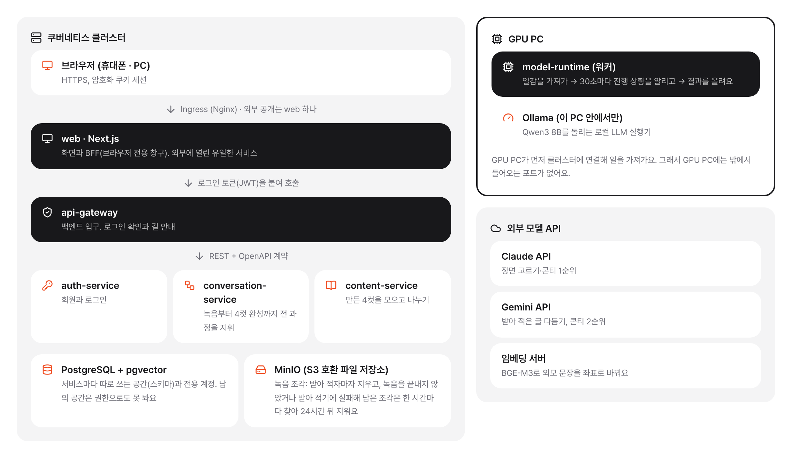

# 4cut story

**대화를 녹음하면 AI가 4컷 만화로 그려 주는 서비스**

녹음 대신 뉴스 기사 주소를 넣거나 RSS 피드를 구독해 두어도 4컷이 만들어져요.

### [4cut.java21.net](https://4cut.java21.net)에서 바로 만들어 볼 수 있어요

[데모](https://4cut.java21.net) · [소개](https://4cut.java21.net/about) · [아키텍처](https://github.com/4cut-story/.github/blob/main/docs/architecture.md) · [AI 모델](https://github.com/4cut-story/.github/blob/main/docs/models.md) · [개선 기록](https://github.com/4cut-story/.github/blob/main/docs/improvements.md)

---

## 소개

4cut story는 친구, 가족과 나눈 대화나 뉴스 기사를 4컷 만화로 바꿔 주는 서비스예요. 휴대폰으로 녹음하면 AI가 받아 적고, 이야기가 되는 순간을 골라 콘티를 짜고, 같은 인물을 컷마다 그려 말풍선까지 넣은 한 장으로 완성해요. 완성한 만화는 피드에 올려 다른 사람과 나누고, 좋아요와 댓글, 팔로우로 이어 볼 수 있어요.

이 프로젝트는 연수생 수업을 위해 만들었어요. 예제 코드가 아니라 실제로 사용자가 쓰는 서비스를 처음부터 끝까지 만들고 운영하면서, 현업에서 마주치는 문제를 직접 겪고 풀어 보는 것이 목적이에요.

## 학습 목표

이 프로젝트를 따라가면 하나의 서비스가 설계에서 운영까지 어떻게 이어지는지 볼 수 있어요.

- **서비스를 나누는 기준** 마이크로서비스 5개와 GPU 워커로 역할을 나누고, OpenAPI 계약을 먼저 정한 뒤 구현해요. 서비스 경계를 어디에 긋는지, 모듈로 둘지 서비스로 뺄지를 실제 사례로 판단해 봐요
- **인증과 보안** GitHub·Google 로그인, JWT와 갱신 토큰, 토큰을 브라우저에 두지 않는 BFF 구조, 개인 액세스 토큰, SSRF 차단, NetworkPolicy처럼 실제 공격면을 생각한 설계를 다뤄요
- **데이터와 비동기 처리** 큐 서버 없이 PostgreSQL `SKIP LOCKED`로 작업 대기열을 만들고, 임대 연장과 실패한 단계부터 다시 하기로 오래 걸리는 작업을 안정적으로 처리해요
- **AI를 서비스에 붙이는 법** LLM 구조화 출력(JSON 스키마), Claude → Gemini → 로컬 모델 대체, 임베딩과 pgvector 검색, 음성 인식과 그림 모델을 하나의 흐름으로 묶어요. 모델을 쓰는 것뿐 아니라 실패했을 때 어떻게 버티는지를 배워요
- **제한된 자원 안에서 설계하기** 16GB GPU 한 장에 여러 모델을 나눠 올리고, 메모리·속도·라이선스를 함께 따져 모델을 골라요
- **측정으로 개선하기** 고정한 시험 세트로 고치기 전후를 같은 조건에서 채점하고, 점수가 오를 때만 반영해요. 감이 아니라 숫자로 결정하는 습관을 익혀요
- **배포와 운영** GitHub Actions, 정적 분석과 커버리지 80% 기준, GHCR, Argo CD로 이어지는 GitOps 배포와 Kubernetes 운영을 직접 해 봐요
- **개인정보를 다루는 책임** 실명을 가명으로 바꾸고, 원본 녹음을 바로 지우고, 실존 인물·기업을 일반 표현으로 바꾸는 규칙을 기능으로 구현해요

## 주요 기능

- **녹음 한 번으로 만화** 휴대폰 브라우저로 녹음하면 받아 적고, 웃음·반전·진심이 담긴 순간을 골라 4~10컷으로 그려요. 한 인물에게는 손 동작 하나만 남겨 손이 셋으로 그려지지 않게 해요
- **기사·RSS로 만화** 기사 속 사실만 가져와 새 대화로 각색하고, 구독한 피드는 새 기사로 저절로 만들되, 구독마다 하루 10편을 하루 동안 고르게 나눠 만들고, 기사마다 절반쯤은 사투리를 자동으로 섞어요
- **같은 인물, 같은 얼굴** 캐릭터 903명(참조 그림 37,926장) 중 어울리는 인물을 골라 모든 컷에서 같은 모습으로 그려요. 군인·경찰·의사처럼 역할이 있는 인물은 그 역할 옷을 입은 캐릭터를 먼저 고르고, 없으면 얼굴만 따와 역할 옷으로 그려요
- **테마와 사투리** 그림 테마 7가지, 사투리에 맞춘 대사, 말풍선까지 넣은 한 장으로 완성해요
- **움직이는 라이브 모드** 만화를 열면 컷을 한 장씩 넘기며 배경음·효과음과 인물 목소리로 대사를 읽어 주고, 배경이 움직여요.
- **소리 검색 API** 배경음·효과음을 말로 찾는 REST API(`/api/open/v1/sounds`). 프로필에서 발급한 소리 검색 토큰으로 부르고, 종류·분위기로 거르고 미리 듣기 MP3 주소와 저작자 표시를 함께 줘요. Freesound API로 받은 소리는 약관에 따라 API에서 빠져요
- **개인정보 보호** 실명은 가명으로 바꾸고, 원본 녹음은 받아 적자마자 지워요

## 한눈에 보기

| 서비스 + GPU 워커 | 단계별 AI 모델 | 컷 한 장 그리기 | 그림 품질 점수 |
| :---: | :---: | :---: | :---: |
| **5 + 1** | **11개** | **약 5.4초** | **81.4 → 97.5점** |

- **GPU 한 장으로** 모델 세 묶음을 RTX 5060 Ti 16GB 한 장에 나눠 올리고, 모델 전환은 1.2~1.4초
- **포트 없는 GPU 연결** GPU PC 워커가 HTTPS로 일을 가져가는(pull) 구조라 PC가 꺼져 있어도 일은 대기열에 남아요
- **멈추지 않는 LLM** Claude → Gemini → 로컬 Qwen3 8B 순서로 대체해요
- **가벼운 게시물** 그림을 WebP로 바꾸고 화면 폭에 맞춰 줄여, 7컷 게시물을 처음 열 때 39.3MB → 약 1.4MB

## 아키텍처

밖에 열린 것은 **web 하나**이고, 그 뒤에서 서비스 다섯 개가 역할을 나눠 맡아요. GPU가 필요한 일은 PostgreSQL 대기열(`SKIP LOCKED`)에 쌓이고 GPU PC 워커가 가져가 처리해요. 배포는 GitHub Actions → GHCR → Argo CD로 자동으로 이어져요.

서비스별 역할, 통신 방식, 로그인·배포 흐름은 [아키텍처 문서](https://github.com/4cut-story/.github/blob/main/docs/architecture.md)에 있어요.

## 기술 스택

| 분야 | 사용한 것 |
| --- | --- |
| **웹** | Next.js 16 · React 19 · TypeScript · Tailwind CSS v4 |
| **백엔드** | Java 21 · Spring Boot 4 · Spring Cloud Gateway · Spring Modulith · Spring AI |
| **AI 실행** | Python · PyTorch · diffusers · WhisperX · Ollama |
| **AI 모델** | WhisperX · Claude · Gemini · Qwen3 · BGE-M3 · FLUX.2 klein |
| **데이터** | PostgreSQL · pgvector · Flyway · MinIO |
| **운영** | Kubernetes · Argo CD · GitHub Actions · GHCR |

## 저장소

저장소마다 README에 하는 일, 시스템 안에서의 위치, 실행 방법을 적어 두었어요.

| 저장소 | 설명 |
| --- | --- |
| [**web**](https://github.com/4cut-story/web) | 화면과 BFF. 외부에 열린 유일한 서비스 |
| [**api-gateway**](https://github.com/4cut-story/api-gateway) | 백엔드 입구, JWT 확인, 워커 전용 경로 |
| [**auth-service**](https://github.com/4cut-story/auth-service) | GitHub·Google 로그인, 토큰, 개인 액세스 토큰 |
| [**conversation-service**](https://github.com/4cut-story/conversation-service) | 녹음부터 4컷 완성까지 지휘, GPU 작업 대기열, LLM 대체 |
| [**content-service**](https://github.com/4cut-story/content-service) | 내 스토리, 게시, 피드, 좋아요, 댓글, 팔로우 |
| [**model-runtime**](https://github.com/4cut-story/model-runtime) | GPU PC 워커, 그림 모델 비교 기록 |
| [**common**](https://github.com/4cut-story/common) | OpenAPI 계약과 공통 코드 |
| [**deploy**](https://github.com/4cut-story/deploy) | 쿠버네티스 배포 설정 (Argo CD) |
| [**docs**](https://github.com/4cut-story/docs) | 설계 문서와 개선 기록 |

## 자세한 문서

| 문서 | 내용 |
| --- | --- |
| [아키텍처](https://github.com/4cut-story/.github/blob/main/docs/architecture.md) | 서비스별 역할, 통신 방식, 저장소, GPU 작업·로그인·배포 흐름 |
| [생성 흐름](https://github.com/4cut-story/.github/blob/main/docs/pipeline.md) | 녹음·기사에서 4컷까지 단계별 규칙, 캐릭터 찾기, 배경음, 가상 인물 목소리 |
| [AI 모델](https://github.com/4cut-story/.github/blob/main/docs/models.md) | 단계별 모델과 설정값, 그림 모델 비교, 콘티 틀과 2단 그리기 |
| [하드웨어](https://github.com/4cut-story/.github/blob/main/docs/hardware.md) | GPU PC와 쿠버네티스 클러스터 구성 |
| [설계 결정](https://github.com/4cut-story/.github/blob/main/docs/design-decisions.md) | 고른 것과 버린 대안, 그 이유 |
| [개선 기록](https://github.com/4cut-story/.github/blob/main/docs/improvements.md) | 성능 개선과 문제 해결 기록 |
| [직접 만든 도구](https://github.com/4cut-story/.github/blob/main/docs/tools.md) | Crowfoot(ERD), nginx-manager |
| [용어 풀이](https://github.com/4cut-story/.github/blob/main/docs/glossary.md) | 문서에 나오는 용어 설명 |

---

**녹음 한 번이 4컷 만화가 되는 서비스** · [4cut.java21.net](https://4cut.java21.net)

