

  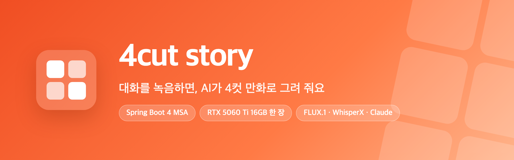

  

  

 

## ✨ 한눈에 보기

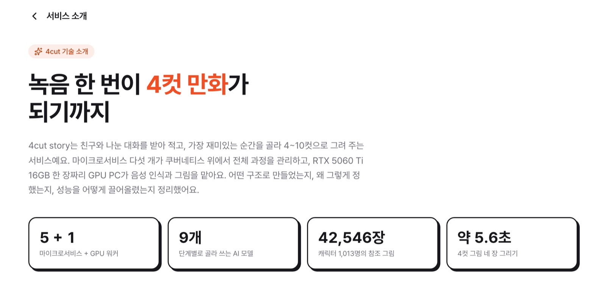

친구, 가족과 나눈 대화를 휴대폰 브라우저로 녹음하면, AI가 받아 적고 웃음·반전·진심·추억이 담긴 순간을 골라 **4~10컷 만화**로 그려요. 그림 테마 7가지와 사투리에 맞춰 대사를 다듬고, 컷마다 그림을 그려 말풍선까지 넣은 한 장으로 완성해요.

<table>
<tr>
<td width="33%" valign="top">

### 🖥️ GPU 한 장으로 끝까지
합계 약 25GB가 필요한 모델 세 묶음을 **RTX 5060 Ti 16GB** 한 장에 나눠 올려요. 모델 전환은 **86~194초 → 1.2~1.4초**.

</td>
<td width="33%" valign="top">

### 🔌 포트 없는 GPU 연결
GPU PC 워커가 HTTPS로 일을 **가져가는(pull)** 구조. PC가 꺼져 있어도 일은 대기열에 남았다가 켜지면 이어서 처리돼요.

</td>
<td width="33%" valign="top">

### 📊 측정으로 고르는 모델
같은 콘티 47컷을 같은 시드로 **14가지 방식**으로 다시 그려 점수·속도·메모리·라이선스로 운영 모델을 골랐어요.

</td>
</tr>
<tr>
<td valign="top">

### 🛟 멈추지 않는 LLM
**Claude → Gemini → 로컬 Qwen3 8B** 3단 대체. 외부 API가 모두 막혀도 만화가 끝까지 만들어져요.

</td>
<td valign="top">

### 📈 점수가 오를 때만
고정한 시험 세트로 고치기 전후를 같은 조건에서 채점. 그림 점수 **81.4 → 91.2 → 97.5점**.

</td>
<td valign="top">

### 🔒 개인정보 보호
실명은 가명으로, 원본 녹음은 **받아 적자마자 삭제**. 끝내지 않은 녹음도 24시간 안에 지워요.

</td>
</tr>
</table>

### 🎨 실제로 그린 컷

곰과 토끼의 마트 시식 코너 이야기를 이전 그림 모델 **FLUX.1-schnell nunchaku FP4**로 그린 네 컷이에요. 지금은 캐릭터 그림을 직접 참조하는 **FLUX.2 klein 4B**로 그려요(아래 [그림 모델 비교](#-그림-모델-비교)). (말풍선은 합치기 단계에서 코드로 넣어요.)

<table>
<tr>
<td>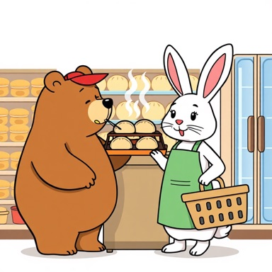</td>
<td></td>
<td></td>
<td></td>
</tr>
<tr>
<td align="center"><b>기</b> · 시식 쟁반을 노리는 곰</td>
<td align="center"><b>승</b> · 모자를 눌러쓰고 몰래 접근</td>
<td align="center"><b>전</b> · 이쑤시개를 든 채 얼어붙음</td>
<td align="center"><b>결</b> · 만두 두 봉지를 든 토끼</td>
</tr>
</table>

 

## 🏗️ 전체 아키텍처

밖에서 보이는 것은 **web 하나**예요. 그 뒤에서 서비스 다섯 개가 역할을 나눠 맡고, GPU가 필요한 일은 GPU PC의 워커가 가져가 처리해요.

<b>📦 서비스별 역할 · 통신 방식 · 데이터 저장소 · 세 가지 흐름 자세히 보기</b>

 

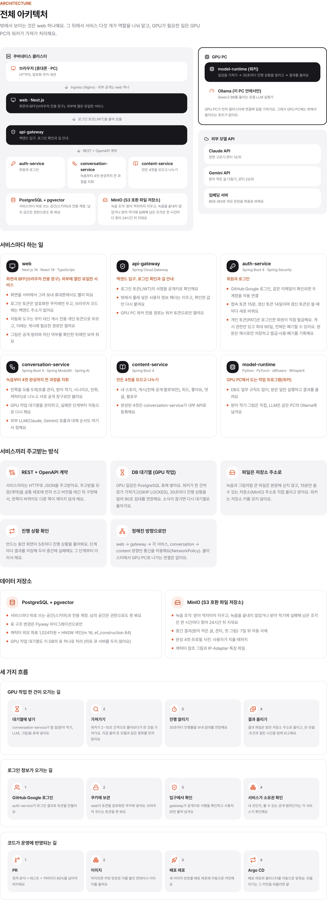

| 핵심 설계 | 내용 |
| --- | --- |
| 🧩 **배포 단위 7개** | 생성 과정은 conversation-service 안 모듈 5개로 나누고, Spring Modulith 테스트로 경계를 지켜요 |
| 📥 **큐 서버 없는 대기열** | PostgreSQL 표 + `SKIP LOCKED`. 워커가 30초마다 진행을 알려 90초 임대를 연장해요 |
| 📁 **파일은 저장소 주소로** | 녹음·그림은 15분짜리 MinIO 주소로 직접 올리고 받아요. 워커는 저장소 키가 없어요 |
| 🔐 **토큰은 BFF가 보관** | 암호화 쿠키에만 두고, 브라우저 코드에는 토큰도 백엔드 주소도 없어요 |
| 🚦 **정해진 방향으로만** | web → gateway → 서비스, conversation → content만 NetworkPolicy로 허용 |
| 🚀 **자동 배포** | PR(정적 분석 · 커버리지 80%) → GHCR 이미지 → deploy 레포 자동 커밋 → Argo CD 동기화 |

 

## 🔄 생성 흐름

사용자는 **녹음만** 해요. 나머지 단계는 conversation-service가 차례로 돌리고, 실패한 단계부터 자동으로 다시 시도해요.

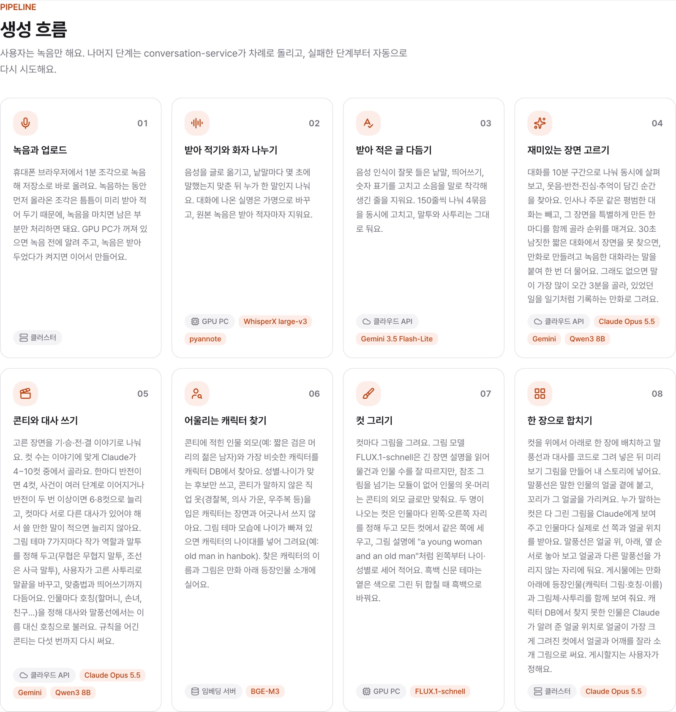

 

## 🧑‍🎨 캐릭터 찾기

대화 속 사람에게 어울리는 캐릭터를 **1,013명** 중에서 골라 모든 컷에서 같은 인물로 그려요. 외모 문장을 1,024차원 임베딩(BGE-M3)으로 바꾸고 pgvector HNSW로 찾은 뒤, 성별·나이를 거르고 **거리 0.30** 안쪽만 써요. 기준은 1,288개 문장으로 재서 정했어요.

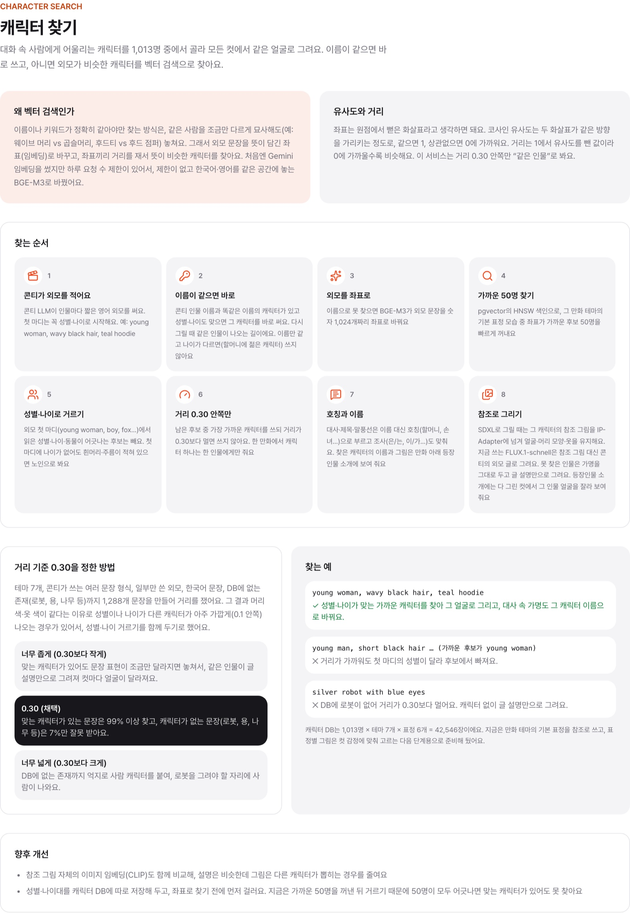

 

## 🎧 배경음 라이브러리

만화 장면에 붙일 배경음 **2,852개**(장소·환경음 1,194, 효과음 879, 배경음악 779개, 306개 카테고리)를 미리 모아 두었어요. 한 카테고리에 비슷한 소리를 많이 두기보다 카테고리마다 서로 다른 소리를 몇 개씩 두어 범위를 넓혔어요. FSD50K와 Free Music Archive에서 상업 사용과 변경이 자유로운 **CC0·CC BY** 클립만 골랐고, 소리마다 출처·작가·라이선스를 함께 저장해 배경음 페이지에 보여 줘요. 소리 자체는 CLAP으로 512차원, 한국어 설명은 BGE-M3로 1,024차원 임베딩을 만들어 pgvector에 넣어서 비슷한 소리 찾기와 글로 찾기를 둘 다 할 수 있어요. 배경음과 캐릭터 갤러리는 로그인하지 않아도 사이트 메뉴(캐릭터 옆 "배경음")에서 바로 둘러볼 수 있어요.

 

## 🤖 사용한 AI 모델

모델 하나로 다 하지 않고, 단계마다 잘하는 모델 **9개**를 골라 이어 붙였어요.

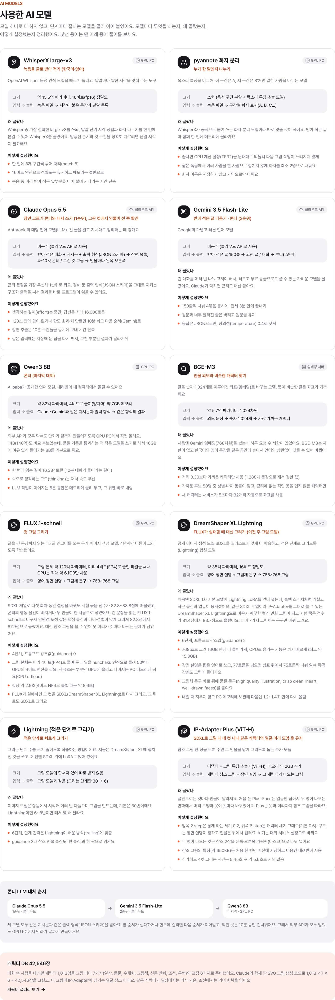

 

## 🧪 그림 모델 비교

16GB GPU에서 더 큰 모델이나 더 정밀한 양자화가 만화를 나아지게 하는지 재기 위해, **콘티 10편 47컷을 같은 프롬프트·같은 시드·같은 렌더러**로 여러 방식으로 다시 그려 편마다 두 번 채점했어요.

<table>
<tr>
<td align="center" width="25%">⚖️ <b>라이선스</b> 상업 서비스에 쓸 수 있는가</td>
<td align="center" width="25%">💾 <b>16GB 메모리</b> RTX 5060 Ti 한 장에 들어가는가</td>
<td align="center" width="25%">⚡ <b>속도</b> 컷당 몇 초인가</td>
<td align="center" width="25%">🧬 <b>캐릭터 참조</b> 같은 인물을 그릴 수 있는가</td>
</tr>
</table>

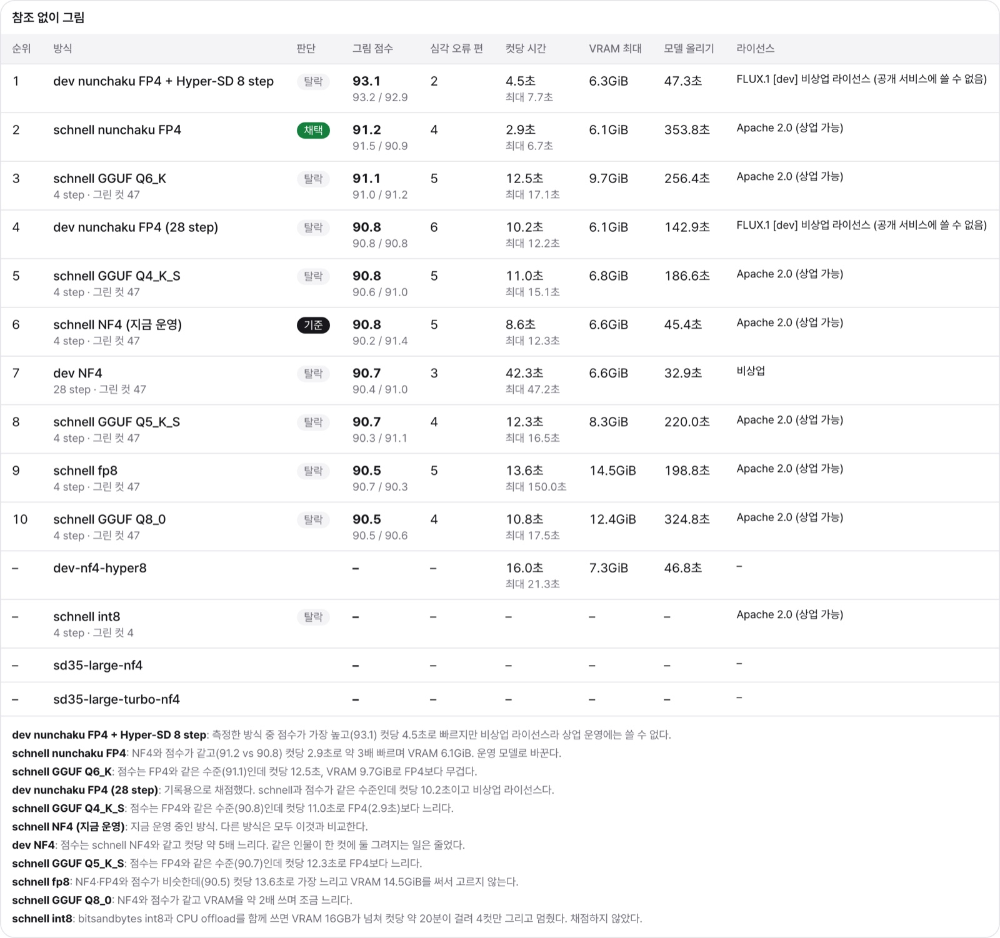

| | 방식 | 점수 | 컷당 | VRAM | 라이선스 |
| :---: | --- | :---: | :---: | :---: | --- |
| ✅ | **FLUX.2 klein 4B NF4 + 캐릭터 참조** (채택) | **92.7** | 5.4초 | **3.7GiB** | Apache 2.0 |
| | FLUX.1-schnell nunchaku FP4 (이전 채택) | 91.2 | **2.9초** | 6.1GiB | Apache 2.0 |
| | FLUX.1-schnell NF4 (이전 기준) | 90.8 | 8.6초 | 6.6GiB | Apache 2.0 |
| | FLUX.1-schnell GGUF Q6_K / Q8_0 | 91.1 / 90.5 | 12.5 / 10.8초 | 9.7 / 12.4GiB | Apache 2.0 |
| | FLUX.1-schnell fp8 | 90.5 | 13.6초 | 14.5GiB | Apache 2.0 |
| ⛔ | FLUX.1-dev FP4 + Hyper-SD 8 step | 93.1 | 4.5초 | 6.3GiB | 비상업 |
| ⛔ | FLUX.1-dev NF4 (28 step) | 90.7 | 42.3초 | 6.6GiB | 비상업 |

> **결론** 더 큰 모델이나 더 정밀한 양자화는 점수를 의미 있게 올리지 못했어요(채점 흔들림 약 3점). 상업 사용이 되는 방식 중 점수가 같으면서 **약 3배 빠르고 가장 가벼운 schnell nunchaku FP4**로 운영 모델을 바꿨어요. 캐릭터 참조로 그린 SDXL + IP-Adapter는 82.8점이라, 참조할 수 있는 모델끼리 따로 겨뤄요.

> **그다음** schnell은 참조 그림을 받을 수 없어 같은 인물의 옷·머리가 컷마다 바뀌었어요. 참조 그림을 받는 모델끼리 같은 시험 묶음으로 다시 겨뤄, 캐릭터 그림을 최대 4장까지 직접 입력으로 받는 **FLUX.2 klein 4B**(Apache 2.0, NF4, 4 step, guidance 1, 768px)로 바꿨어요. 컷당 약 5.4초, VRAM 최대 약 3.7GB이고, klein이 실패하면 그 컷을 SDXL DreamShaper XL Lightning으로 다시 그려요.

### 콘티 틀과 2단 그리기

그림 모델을 바꾼 뒤에는 콘티 쪽을 고쳤어요. 시험 묶음 10편을 같은 조건으로 다시 그리며 틀을 25판까지 고쳤고, 한 편만 맞추는 수정은 하지 않았어요.

- **칸 나눈 콘티 틀** 인물의 옷·소품·장소를 한 번만 정하고, 컷에서는 이름표로만 가리켜요. 1컷의 목검이 2컷에서 쇠칼로 바뀌는 일이 없어져요. 한 컷에는 한 사람, 한 동작, 물건 하나만 써요.
- **2단 그리기** 물건을 손에 든 컷과 두 사람이 나오는 컷은 두 번에 나눠 그려요. 먼저 빈손 자세나 앞사람을 그리고, 그 그림을 다시 넣어 물건이나 뒷사람만 더해요. 사람이 섞이거나 물건이 둘로 그려지는 것을 막아요.

| | 시험 묶음 점수 | 심각한 오류가 있는 편 |
| --- | :---: | :---: |
| FLUX.1-schnell nunchaku FP4 | 91.2 | |
| FLUX.2 klein 4B + 캐릭터 참조 | 92.7 | 4편 |
| + 콘티 틀 + 2단 그리기 | **97.5** | **0편** |

### 같은 콘티, 다른 그림 모델

<table>
<tr><th>방식</th><th>기</th><th>승</th><th>전</th><th>결</th></tr>
<tr><td><b>✅ schnell FP4</b> 95.3점 · 2.9초</td><td></td><td></td><td></td><td></td></tr>
<tr><td><b>schnell NF4</b> 94.9점 · 8.6초</td><td>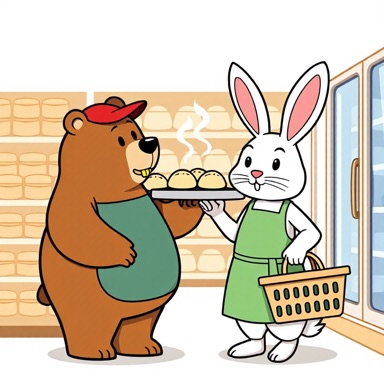</td><td>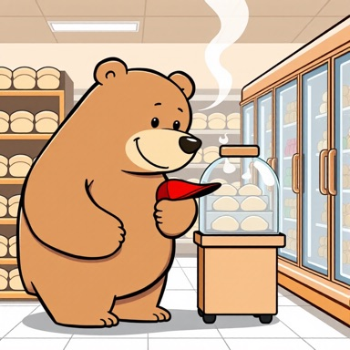</td><td></td><td></td></tr>
<tr><td><b>schnell Q8_0</b> 95.8점 · 10.8초</td><td>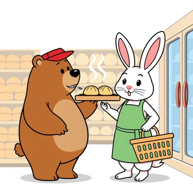</td><td>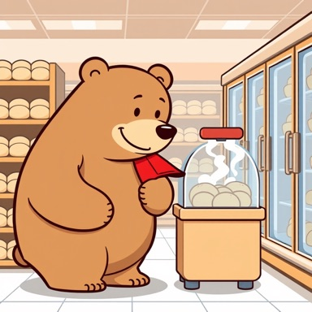</td><td></td><td></td></tr>
<tr><td><b>⛔ dev FP4</b> 94.9점 · 4.5초</td><td></td><td>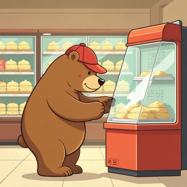</td><td>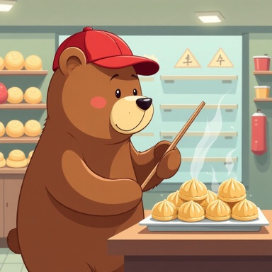</td><td></td></tr>
</table>

<b>🖼️ 다른 편의 모델별 비교 그림 더 보기</b>

 

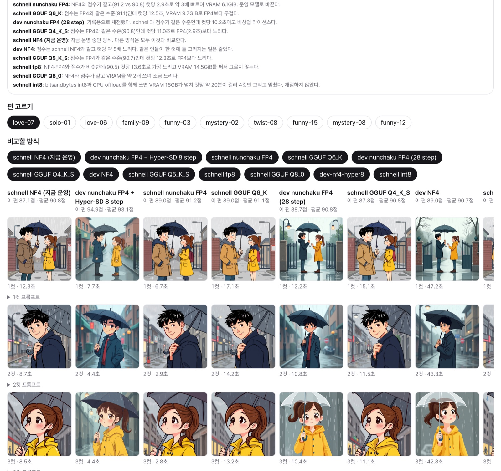

 

## 🖥️ 하드웨어 환경

유료 GPU 서버 없이 **소비자용 GPU 한 장**으로 돌려요. 세 모델 묶음을 한꺼번에 올리면 16GB를 넘기 때문에, 단계마다 한 묶음만 올리고 내려요.

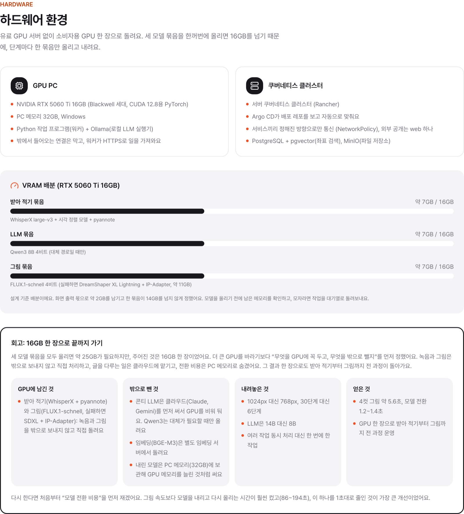

 

## 🧭 설계 결정과 대안

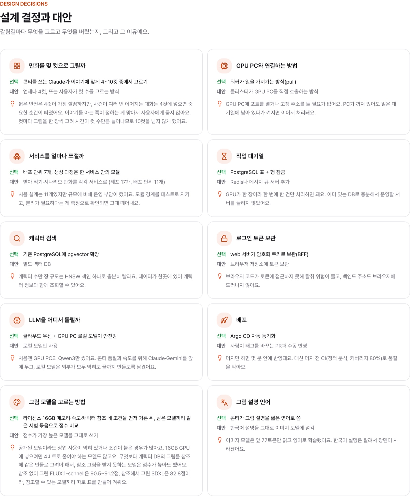

 

## 🚀 성능 개선과 문제 해결

GPU PC와 운영 환경에서 직접 재고 고친 것들이에요. 항목마다 **문제 → 원인 → 해결 → 전후 비교** 순서예요.

<table>
<tr>
<td align="center">⏱️ <b>86~194초 → 1.2초</b> 모델 다시 올리기</td>
<td align="center">⚡ <b>8.6초 → 2.9초</b> 컷당 그리기</td>
<td align="center">🎯 <b>81.4 → 97.5점</b> 그림 점수</td>
<td align="center">💬 <b>1.05 → 1.25점</b> 말풍선 자리</td>
<td align="center">🧑‍🤝‍🧑 <b>틀림 0건</b> 캐릭터 성별·나이</td>
</tr>
</table>

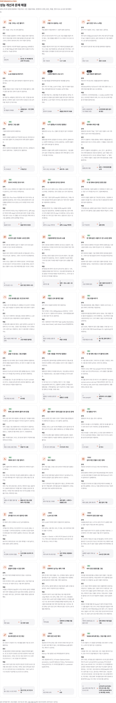

 

## 🛠️ 직접 만들어 쓰는 도구

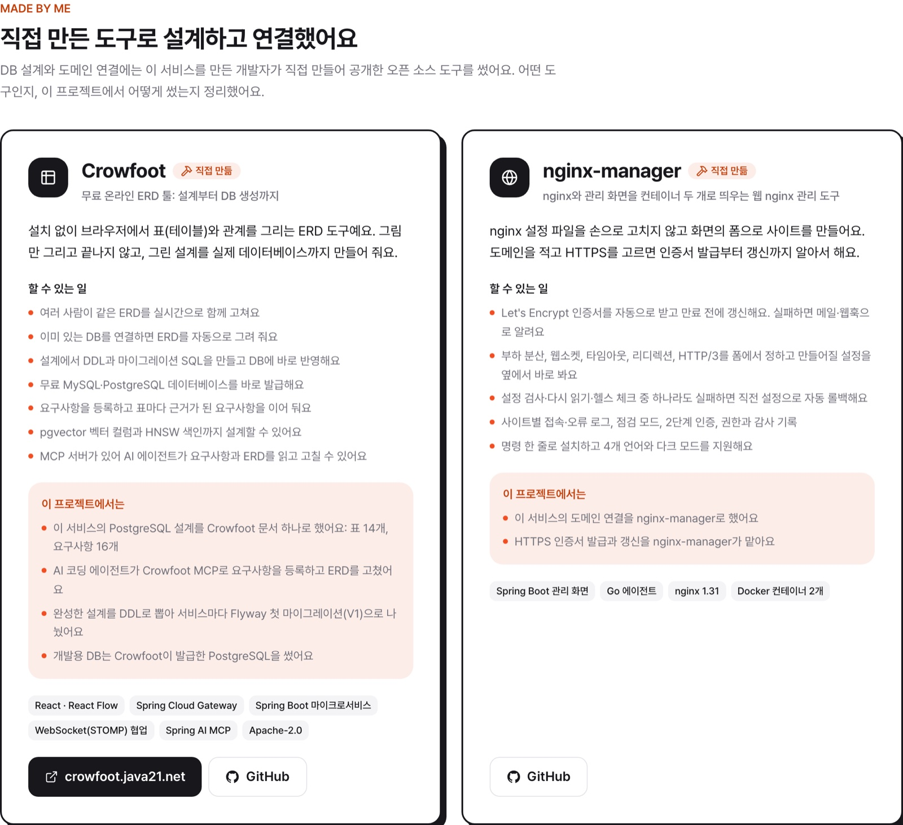

- **[Crowfoot](https://crowfoot.java21.net)** ([GitHub](https://github.com/crowfoot-erd)): 설계부터 DB 생성까지 하는 무료 온라인 ERD 툴
- **[nginx-manager](https://github.com/nginx-manager)**: 웹 화면으로 nginx와 HTTPS 인증서를 관리하는 도구

 

## 🧰 기술 스택과 품질 기준

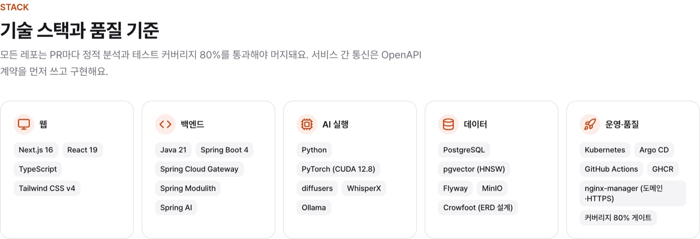

 

## 📂 저장소

| | 저장소 | 역할 |
| :---: | --- | --- |
| 🌐 | [**web**](https://github.com/4cut-story/web) | 화면과 BFF. 외부에 열린 유일한 서비스 |
| 🚪 | [**api-gateway**](https://github.com/4cut-story/api-gateway) | 백엔드 입구, JWT 확인, 워커 전용 경로 |
| 🔑 | [**auth-service**](https://github.com/4cut-story/auth-service) | GitHub·Google 로그인, 토큰, 개인 액세스 토큰 |
| 🎙️ | [**conversation-service**](https://github.com/4cut-story/conversation-service) | 녹음부터 4컷 완성까지 지휘, GPU 작업 대기열, LLM 대체 |
| 📚 | [**content-service**](https://github.com/4cut-story/content-service) | 내 스토리, 게시, 피드, 좋아요, 댓글, 팔로우 |
| 🖥️ | [**model-runtime**](https://github.com/4cut-story/model-runtime) | GPU PC 워커, 그림 모델 비교 기록 |
| 📜 | [**common**](https://github.com/4cut-story/common) | OpenAPI 계약과 공통 코드 |
| ☸️ | [**deploy**](https://github.com/4cut-story/deploy) | 쿠버네티스 배포 설정 (Argo CD) |
| 📝 | [**docs**](https://github.com/4cut-story/docs) | 설계 문서와 개선 기록 |

<b>📖 용어 풀이</b>

 

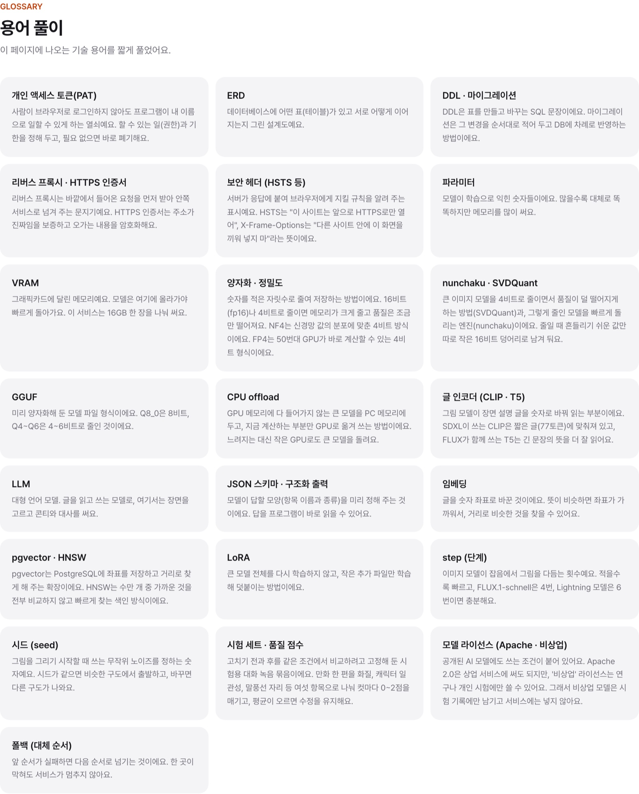

 

   
  <b>녹음 한 번이 4컷 만화가 되는 서비스</b> 
  <a href="https://4cut.java21.net"><b>4cut.java21.net</b></a>

